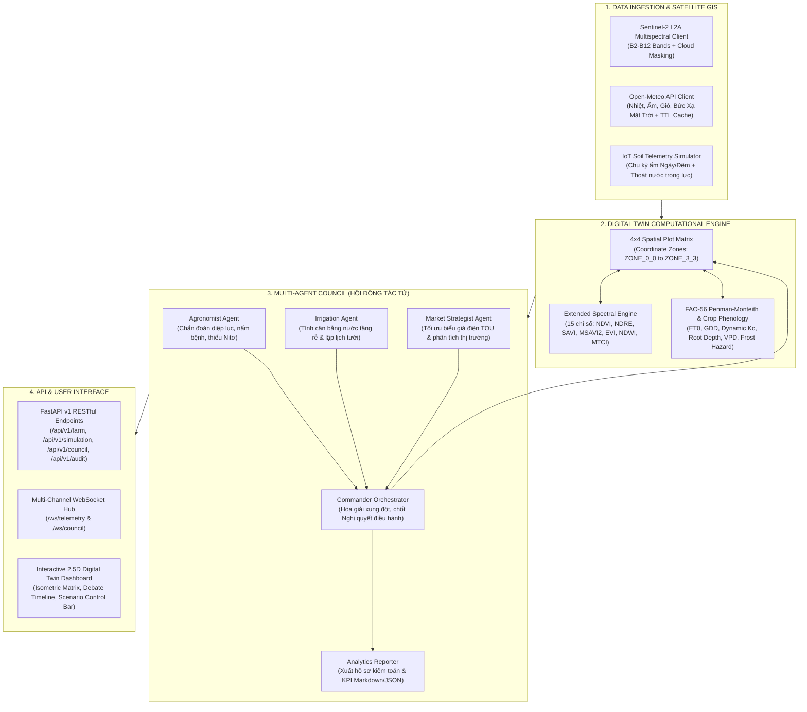

# 🌾 Farm_com: Autonomous Farm OS & Multi-Agent Swarm

> **Precision Agriculture Digital Twin & Multi-Agent Decision Platform**  
> Kết hợp ảnh viễn thám vệ sinh Sentinel-2 L2A, dự báo thời tiết Open-Meteo, mô hình sinh lý nông học FAO-56 Penman-Monteith, mô hình nhiệt tích lũy GDD và Hội đồng Đa tác tử (Multi-Agent Swarm Council).

[](https://www.python.org/)
[](https://fastapi.tiangolo.com/)
[](https://docs.pydantic.dev/)
[](tests/)
[](https://github.com/astral-sh/ruff)

---

## 🏗️ 1. Kiến Trúc Hệ Thống (System Architecture)




---

## 📂 2. Cấu Trúc Mã Nguồn & Bản Đồ Module (Repository Map)

Dành cho **AI Coding Agents** và **Developers** tiếp nhận dự án:

```text
e:\z_farm_com\
│
├── backend\                             # Core source package
│   ├── config.py                        # Cấu hình Pydantic Settings (toạ độ farm, ngưỡng cảnh báo, credentials)
│   ├── main.py                          # FastAPI application, lifespan startup, WebSocket & Static server
│   │
│   ├── core\                            # LÕI DIGITAL TWIN & CÔNG THỨC NÔNG HỌC
│   │   ├── __init__.py                  # Exported API: ExtendedSpectralEngine, PhenologyEngine, FAO-56...
│   │   ├── twin_state.py                # Pydantic v2 schemas: PlotZone, FarmDigitalTwin, WeatherTelemetry, ActionLog
│   │   ├── agronomy_models.py           # Phương trình FAO-56 Penman-Monteith chuẩn, cân bằng nước & GDD cơ bản
│   │   ├── spectral.py                  # Công thức viễn thám cơ bản (NDVI, NDWI, EVI)
│   │   ├── extended_spectral.py         # 15 chỉ số thực vật nâng cao: GNDVI, NDRE, SAVI, MSAVI2, MTCI, NDDI...
│   │   └── crop_phenology.py            # Mô hình nhiệt BBCH, hệ số Kc động, độ sâu rễ Sigmoidal & hàm tổn thất năng suất Ky
│   │
│   ├── ingestion\                       # TẦNG KÉO DỮ LIỆU & GIẢ LẬP NGOẠI VI
│   │   ├── __init__.py                  # Exported API: WeatherClient, SatelliteClient, SensorSimulator...
│   │   ├── weather_client.py            # Async Open-Meteo client với bộ nhớ đệm TTL 300s & exponential retry
│   │   ├── satellite_client.py          # Bộ giả lập 10 dải Sentinel-2 L2A & đánh giá chất lượng quang học theo mây
│   │   ├── sensor_sim.py                # Mô phỏng vật lý đất IoT: bốc thoát hơi ngày/đêm, thoát nước trọng lực & nạp ẩm tưới
│   │   └── weather_forecast.py          # Phân tích áp suất hơi bão hòa (VPD), bức xạ Hargreaves & nguy cơ trôi giọt thuốc BVTV
│   │
│   ├── agents\                          # HỘI ĐỒNG ĐA TÁC TỬ (MULTI-AGENT SWARM)
│   │   ├── __init__.py                  # Exported API: Agronomist, Irrigation, Market, Commander, Reporter...
│   │   ├── base_agent.py                # Interface BaseFarmAgent & cấu trúc ý kiến AgentOpinion (Pydantic v2)
│   │   ├── agronomist.py                # Tác tử Bác sĩ cây trồng (diệp lục, nấm bệnh từ nhiệt-ẩm)
│   │   ├── irrigation.py                # Tác tử Kỹ sư thủy nông (tính ETc, thâm hụt nước & lưu lượng tưới)
│   │   ├── market.py                    # Tác tử Kinh tế (giờ điện cao điểm/thấp điểm, giá nông sản)
│   │   ├── commander.py                 # Tác tử Tổng chỉ huy (tổng hợp đa mục tiêu, phát lệnh FarmCouncilVerdict)
│   │   └── analytics_reporter.py        # Bộ tạo báo cáo kiểm toán điều hành (Dossier Markdown/JSON)
│   │
│   ├── api\                             # REST ROUTERS
│   │   ├── routes_farm.py               # /api/farm (lấy trạng thái nông trại, kích hoạt tick mô phỏng)
│   │   └── routes_agents.py             # /api/agents (triệu tập hội đồng tác tử)
│   │
│   └── static\                          # FRONTEND GIAO DIỆN
│       └── index.html                   # Dashboard trực quan hóa ma trận 4x4 & phòng họp hội đồng Agent
│
├── scripts\                             # CÔNG CỤ DÒNG LỆNH & KIỂM ĐỊNH (CLI TOOLS)
│   ├── check_ingestion.py               # CLI kiểm tra kết nối API Open-Meteo & tổng hợp quang phổ Sentinel-2
│   ├── benchmark_suite.py               # CLI benchmark tính toán nông học (NDVI, GDD, VPD, phân loại sức khỏe)
│   └── github_painter.py                # Tool hỗ trợ streak commit độc lập
│
├── tests\                               # BỘ UNIT TEST TOÀN DIỆN (70 TESTS)
│   ├── test_agronomy.py                 # Tests FAO-56 Penman-Monteith, cân bằng nước & GDD biên độ nhiệt
│   ├── test_crop_phenology.py           # Tests thang sinh trưởng BBCH, Kc động & phát triển rễ
│   ├── test_extended_spectral.py        # Tests 15 chỉ số viễn thám quang phổ thực vật & xử lý chia 0
│   ├── test_weather_forecast.py         # Tests VPD, bức xạ Hargreaves-Samani & vùng gió an toàn phun thuốc
│   ├── test_analytics_reporter.py       # Tests tổng hợp KPI, xuất bản báo cáo Markdown & JSON
│   └── test_ingestion_pipeline.py       # Tests cache thời tiết, lọc mây vệ tinh & chu kỳ ẩm đất ngày/đêm
│
├── pyproject.toml                       # Quản lý dependencies theo chuẩn uv & PEP 621
├── requirements.txt                     # Requirements dự phòng cho môi trường pip truyền thống
├── ROADMAP.md                           # Lộ trình 7 giai đoạn phát triển dự án
└── README.md                            # Tài liệu tổng quan & hướng dẫn kỹ thuật
```

---

## 🧮 3. Các Mô Hình Nông Học & Công Thức Tính Toán

Hệ thống được xây dựng trên nền tảng các tiêu chuẩn nông học quốc tế:

### A. Chỉ số Quang phổ Viễn thám (Spectral Indices)
* **NDVI (Normalized Difference Vegetation Index):**
  $$\text{NDVI} = \frac{\text{NIR} - \text{Red}}{\text{NIR} + \text{Red}}$$
  *Dùng đánh giá mật độ sinh khối và độ che phủ lá (0.6 – 0.9: cây phát triển mạnh).*
* **NDRE (Normalized Difference Red Edge):**
  $$\text{NDRE} = \frac{\text{NIR} - \text{RedEdge}_1}{\text{NIR} + \text{RedEdge}_1}$$
  *Nhạy cảm với hàm lượng diệp lục tầng giữa và cuối mùa vụ mà không bị bão hòa như NDVI.*
* **SAVI (Soil-Adjusted Vegetation Index):**
  $$\text{SAVI} = \frac{\text{NIR} - \text{Red}}{\text{NIR} + \text{Red} + L} \times (1 + L) \quad (L = 0.5)$$
  *Triệt tiêu ảnh hưởng của nền đất trống trong giai đoạn cây con.*
* **NDWI (Canopy Liquid Water Index - Gao 1996):**
  $$\text{NDWI} = \frac{\text{NIR} - \text{SWIR}_1}{\text{NIR} + \text{SWIR}_1}$$
  *Đo lường hàm lượng nước trực tiếp trong mô tế bào lá cây.*

---

### B. Bốc thoát hơi nước FAO-56 Penman-Monteith ($ET_0$)
Tính toán nhu cầu nước bốc thoát tham chiếu:
$$\text{ET}_0 = \frac{0.408 \Delta (R_n - G) + \gamma \frac{900}{T + 273} u_2 (e_s - e_a)}{\Delta + \gamma (1 + 0.34 u_2)}$$
* $\Delta$: Độ dốc đường cong áp suất hơi nước bão hòa $(\text{kPa}/^\circ\text{C})$
* $R_n$: Bức xạ thực trên bề mặt tán lá $(\text{MJ}/\text{m}^2/\text{day})$
* $\gamma$: Hằng số tâm lý ẩm, hiệu chỉnh theo cao trình nông trại (Đà Lạt $\sim 1500\text{m}$)
* $u_2$: Tốc độ gió ở độ cao 2m $(\text{m}/\text{s})$
* $(e_s - e_a)$: Thâm hụt áp suất hơi nước bão hòa (Vapor Pressure Deficit - VPD)

---

### C. Độ tích lũy nhiệt độ GDD (Growing Degree Days) & Hệ số $K_c$ Động
* **Công thức GDD:**
  $$\text{GDD} = \max\left(0, \frac{\min(T_{\max}, T_{\text{cutoff}}) + \max(T_{\min}, T_{\text{base}})}{2} - T_{\text{base}}\right)$$
* **Hệ số cây trồng động $K_c$:**
  * Giai đoạn cây con ($< 15\%$ GDD): $K_c = K_{c,\text{ini}}$
  * Giai đoạn phát triển thân lá ($15\% - 45\%$ GDD): Tăng tuyến tính từ $K_{c,\text{ini}} \to K_{c,\text{mid}}$
  * Giai đoạn nở hoa/tạo quả ($45\% - 80\%$ GDD): Đỉnh cao nhất $K_c = K_{c,\text{mid}}$
  * Giai đoạn chín/thu hoạch ($> 80\%$ GDD): Giảm dần về $K_{c,\text{end}}$

---

## 🤖 4. Giao Thức Hội Đồng Đa Tác Tử (Agent Swarm Protocol)

Chu trình nhận thức và ra quyết định của các Agent:
1. **Perceive (Thu nhận):** Đọc trạng thái ma trận Digital Twin (độ ẩm tầng đất, chỉ số quang phổ, vi khí hậu).
2. **Evaluate (Đánh giá độc lập):**
   * **Agronomist:** Phân tích suy giảm diệp lục (Chlorosis), phát hiện nguy cơ nấm bệnh khi độ ẩm $> 85\%$ liên tục.
   * **Irrigation:** So sánh độ ẩm thực tế với ngưỡng tới hạn, tính lưu lượng nước cần bù dựa trên $ET_c = ET_0 \times K_c$.
   * **Market:** Tra cứu biểu giá điện theo khung giờ (Peak/Off-peak), dời lịch bơm sang giờ thấp điểm nếu độ ẩm đất vẫn trong ngưỡng an toàn.
3. **Consensus (Đồng thuận & Chốt quyết định):**
   * **Commander:** Tổng hợp các khuyến nghị có trọng số, giải quyết mâu thuẫn (ví dụ: cứu cây đang hạn cấp tính bất chấp giờ điện cao điểm).
   * **Dispatch:** Ghi sự kiện vào `ActionLog`, kích hoạt mô phỏng tưới và xuất báo cáo kiểm toán thông qua `FarmIntelligenceReporter`.

---

## 🚀 5. Hướng Dẫn Cài Đặt & Chạy Hệ Thống (Quickstart)

### Yêu cầu hệ thống:
* Python `>= 3.13`
* Trình quản lý gói `uv` (khuyên dùng) hoặc `pip` tiêu chuẩn.

### Cài đặt:
```bash
# 1. Clone repository
git clone https://github.com/BaoNguyenz/farm_com.git
cd farm_com

# 2. Cài đặt môi trường với uv (siêu tốc)
uv sync

# Hoặc dùng pip truyền thống:
python -m venv .venv
# Trên Windows:
.venv\Scripts\activate
# Trên Linux/macOS:
source .venv/bin/activate
pip install -r requirements.txt
```

### Chạy hệ thống:
```bash
# Khởi động Backend API & Dashboard UI
python main.py
```
* **Dashboard trực quan:** Mở trình duyệt tại [http://localhost:8000](http://localhost:8000)
* **Tài liệu API Swagger:** [http://localhost:8000/docs](http://localhost:8000/docs)
* **WebSocket Real-time Telemetry:** `ws://localhost:8000/ws/telemetry`

---

## 🧪 6. Kiểm Thử & Chẩn Đoán CLI (Testing & Diagnostics)

### Chạy toàn bộ 70 Unit Tests:
```bash
python -m pytest -v
```
*(Kết quả mong đợi: `70 passed in ~0.3s`)*

### Chạy các công cụ dòng lệnh (CLI Tools):
```bash
# 1. Kiểm tra kết nối API thời tiết Open-Meteo & bộ giả lập Sentinel-2
python scripts/check_ingestion.py

# 2. Benchmark lõi tính toán nông học (NDVI, GDD, VPD, phân loại sức khỏe)
python scripts/benchmark_suite.py
```

### Kiểm tra cú pháp & Linter:
```bash
ruff check .
```
*(Đảm bảo toàn bộ mã nguồn đạt chuẩn 0 lỗi linter)*

---

## 📌 7. Hướng Dẫn Dành Cho AI Coding Agents Trong Phiên Mới

> [!IMPORTANT]
> **Quy tắc bất biến cho AI Agents:**
> 1. **Bảo tồn tính toàn vẹn của Tests:** Tuyệt đối không làm hỏng 70 unit tests hiện tại. Mọi thay đổi logic phải chạy lại `python -m pytest -q` trước khi hoàn tất.
> 2. **Cấu trúc Import:** Mọi package trong `backend/` đều có file `__init__.py` export tường minh. Ưu tiên import từ package level:
>    * `from backend.core import ExtendedSpectralEngine, PhenologyEngine...`
>    * `from backend.ingestion import WeatherClient, SatelliteClient, SensorSimulator...`
>    * `from backend.agents import CommanderAgent, AgronomistAgent, FarmIntelligenceReporter...`
> 3. **Cấu trúc Dữ liệu:** Tất cả schema dùng **Pydantic v2** (`BaseModel`, `Field`, `model_dump()`), không dùng cú pháp Pydantic v1 cũ (`.dict()`).
> 4. **Giữ sạch Repository:** Không sinh ra các file tạm hoặc script rác ngoài thư mục quy định. Mã nguồn mới thuộc tính năng phải nằm trong `backend/`, test tương ứng phải nằm trong `tests/`.
> 5. **Chuẩn Commit:** Sử dụng Conventional Commits (`feat:`, `fix:`, `test:`, `docs:`, `refactor:`).

---

## 📄 Bản Quyền (License)
Dự án được phát triển phục vụ nền tảng Nông nghiệp Thông minh & Bản sao số Đa tác tử (Farm_com OS). Mọi quyền được bảo lưu bởi tác giả **BaoNguyenz**.
