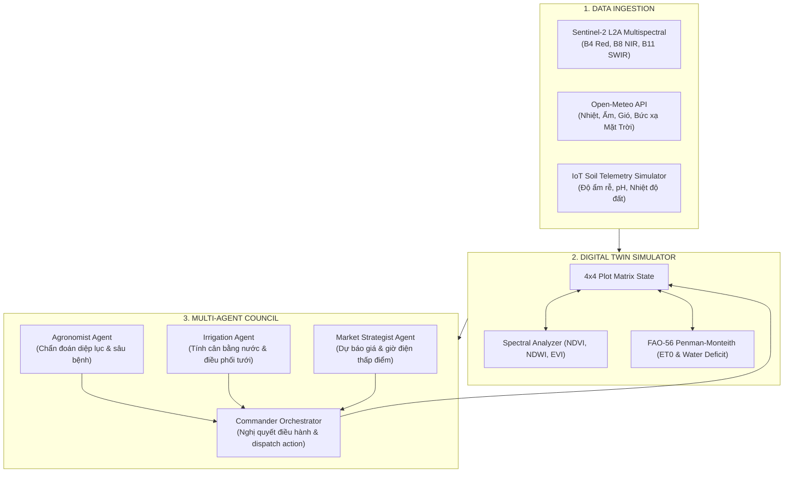

# Farm_com: Autonomous Farm OS & Multi-Agent Swarm

> **Digital Twin Platform & Multi-Agent Swarm for Precision Agriculture**  
> Kết hợp ảnh viễn thám vệ tinh (Sentinel-2), dữ liệu vi khí hậu (Open-Meteo), mô hình nông học tính toán (FAO-56 Penman-Monteith) và hệ thống Đa tác tử (Multi-Agent Council).

---

## 🏗️ Kiến Trúc Hệ Thống



---

## 📂 Cấu Trúc Mã Nguồn

```text
e:\z_farm_com\
│
├── backend\
│   ├── config.py                 # Pydantic Settings (toạ độ farm, credentials)
│   ├── main.py                   # FastAPI app, WebSockets & Static Server
│   │
│   ├── core\                     # Lõi Digital Twin & Mô hình nông học
│   │   ├── twin_state.py         # Data models (PlotZone, FarmDigitalTwin, Telemetry)
│   │   ├── agronomy_models.py    # FAO-56 Penman-Monteith ET0, GDD, Water Deficit
│   │   └── spectral.py           # Công thức NDVI, NDWI, EVI từ quang phổ vệ tinh
│   │
│   ├── ingestion\                # Thu thập dữ liệu
│   │   ├── satellite_client.py   # Client Sentinel-2 / Copernicus
│   │   ├── weather_client.py     # Client thời tiết Open-Meteo (async HTTP)
│   │   └── sensor_sim.py         # Giả lập vật lý bốc thoát hơi & độ ẩm đất
│   │
│   ├── agents\                   # Hội đồng Đa tác tử (Multi-Agent Swarm)
│   │   ├── base_agent.py         # Interface Agent & Structured Opinion
│   │   ├── agronomist.py         # Agent Bác sĩ cây trồng
│   │   ├── irrigation.py         # Agent Kỹ sư thủy nông & tưới tiêu
│   │   ├── market.py             # Agent Kinh tế nông nghiệp & giá thị trường
│   │   └── commander.py          # Agent Giám đốc điều hành & Tổng hợp quyết định
│   │
│   ├── api\                      # REST API Endpoints
│   │   ├── routes_farm.py        # /api/farm (state, zones, tick)
│   │   └── routes_agents.py      # /api/agents (convene council)
│   │
│   └── static\
│       └── index.html            # Dashboard trực quan hóa Digital Twin & Hội đồng Agent
│
├── pyproject.toml            # Cấu hình dự án & dependencies chuẩn uv
├── uv.lock                   # Lockfile xác định phiên bản chính xác
├── main.py                   # Điểm khởi chạy nhanh ứng dụng
├── .env.example
├── .gitignore
├── requirements.txt
└── README.md
```

---

## 🚀 Hướng Dẫn Cài Đặt & Chạy Thử Với `uv`

### 1. Đồng bộ môi trường ảo (tạo `.venv` và cài dependencies siêu tốc):
```bash
uv sync
```

### 2. Khởi chạy Server:
```bash
uv run python main.py
```
*(hoặc dùng lệnh: `uv run uvicorn backend.main:app --reload --port 8000`)*

### 3. Mở Giao Diện Web:
Truy cập trình duyệt tại: **`http://localhost:8000`**

* **Xem Live Digital Twin:** Ma trận 4x4 luống cây (Dâu tây, Cà phê Arabica, Ớt chuông, Cẩm tú cầu) với chỉ số NDVI/NDWI và độ ẩm tầng rễ.
* **Họp Hội Đồng Agent:** Nhấn nút **"Họp Hội Đồng Agent"** để theo dõi các Agent phản biện và ra quyết định tự động.
* **Mô phỏng thời gian:** Nhấn **"Step +1 Hour"** để kiểm tra quá trình bay hơi tự nhiên của đất.

