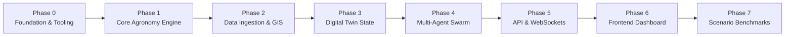

# Farm_com - Lộ Trình Phát Triển Chi Tiết (Project Roadmap)

Dự án được phân rã thành **7 Phases tuần tự**, mỗi Phase gồm các **Tasks độc lập**, có tiêu chuẩn nghiệm thu (Acceptance Criteria) và Unit Test tương ứng để đảm bảo code đến đâu chắc đến đó.

---

## 🧭 Tổng Quan Các Phase

---

## 📌 Phase 0: Chuẩn Hóa Nền Tảng & Công Cụ (Foundation & Tooling)
- [ ] **Task 0.1: Cấu hình Linter & Formatter (`ruff`)**
  - Cài đặt `ruff` và `pytest` qua `uv add --dev ruff pytest`.
  - Cấu hình chuẩn trong `pyproject.toml`.
- [ ] **Task 0.2: Quản Lý Cấu Hình (Pydantic Settings)**
  - Tách bạch cấu hình dev, test và production.
- [ ] **Task 0.3: Thiết Lập Khung Unit Test (`pytest`)**
  - Khởi tạo thư mục `tests/` với các fixture chuẩn (`conftest.py`).

---

## 📌 Phase 1: Lõi Nông Học Tính Toán (Core Biophysical Engine)
- [x] **Task 1.1: Module Quang Phổ Vệ Tinh (`core/spectral.py` & `core/extended_spectral.py`)**
  - Thuật toán NDVI, NDWI, EVI, SAVI, MSAVI2, NDRE, CIgreen, CIrededge.
  - Unit tests cho các trường hợp biên (chia 0, reflectance âm, canopy classification).
- [x] **Task 1.2: Mô Hình Bốc Thoát Hơi Nước FAO-56 Penman-Monteith (`core/agronomy/fao56.py`)**
  - Triển khai phương trình chuẩn FAO-56 ($ET_0$).
  - Unit tests đối chiếu với tập dữ liệu chuẩn của tổ chức FAO.
- [x] **Task 1.3: Cân Bằng Nước & Hệ Số Cây Trồng ($K_c$) (`core/crop_phenology.py`)**
  - Ma trận $K_c$ động theo từng giai đoạn phát triển BBCH của cây.
  - Tính toán thâm hụt nước tầng rễ & mô hình phát triển rễ Sigmoidal.
- [x] **Task 1.4: Mô Hình Nhiệt Độ Tích Lũy GDD (`core/crop_phenology.py`)**
  - Tính Growing Degree Days với $T_{base}$ và $T_{cutoff}$ để dự báo ngày thu hoạch.

---

## 📌 Phase 2: Kéo Dữ Liệu Ngoại Vi & Viễn Thám (Data Ingestion & GIS)
- [x] **Task 2.1: Client Thời Tiết Vi Khí Hậu Open-Meteo (`ingestion/weather_client.py`)**
  - Lấy nhiệt độ, độ ẩm, bức xạ mặt trời MJ/$m^2$, mưa, gió không cần API key.
  - Tích hợp Retry policy lũy thừa và Cache TTL bộ nhớ cục bộ.
- [x] **Task 2.2: Client Vệ Tinh Copernicus / Sentinel-2 (`ingestion/satellite_client.py`)**
  - Giả lập và tổng hợp ma trận 10 dải quang phổ bề mặt Sentinel-2 L2A (B2-B12).
  - Tích hợp bộ đánh giá chất lượng ảnh quang học và mặt nạ mây (Cloud Masking).
- [x] **Task 2.3: Giả Lập Cảm Biến Đất IoT (`ingestion/sensor_sim.py`)**
  - Mô phỏng suy giảm độ ẩm đất theo chu kỳ ngày/đêm, thoát nước trọng lực và bù ẩm tưới tiêu.

---

## 📌 Phase 3: Bản Sao Số & Quản Lý Trạng Thái (Digital Twin State)
- [x] **Task 3.1: Chia Lưới Không Gian (Spatial Grid Discretization)**
  - Chia nông trại thành lưới tọa độ $N \times M$ ô (Plot Zones) với các chỉ số sinh thái riêng biệt và tô pô lân cận (Von Neumann & Moore).
- [x] **Task 3.2: Bộ Điều Phối Bước Thời Gian (Tick Engine)**
  - Hàm `advance_tick(elapsed_hours)` cập nhật đồng bộ các ô đất: nhiệt tích lũy GDD, chuyển pha sinh trưởng BBCH, bốc thoát hơi nước FAO-56 và thoát nước trọng lực.
- [x] **Task 3.3: Dispatcher & Audit Log**
  - Hàng đợi nhận lệnh ActionDispatcher -> Cập nhật trạng thái đất -> Lưu nhật ký bất biến có băm mật mã SHA-256 (AuditReceipt).

---

## 📌 Phase 4: Hội Đồng Đa Tác Tử (Multi-Agent Swarm)
- [x] **Task 4.1: Framework Đa Tác Tử Cơ Bản (`agents/base_agent.py`)**
  - Chu trình: Perceive -> Evaluate -> Debate -> Structured Output với `DebateVote`, `DebateRound` và hệ số trọng số chuyên môn tên miền (`get_domain_weight`: 2.0x domain expertise).
- [x] **Task 4.2: Tác Tử Bác Sĩ Cây Trồng (`agents/agronomist.py`)**
  - Chẩn đoán chỉ số quang phổ NDVI/NDWI, phát hiện nguy cơ bùng phát nấm bệnh từ vector nhiệt - ẩm vi khí hậu (RH > 80% + 16–28°C) và chlorosis thiếu đạm.
- [x] **Task 4.3: Tác Tử Kỹ Sư Thủy Nông (`agents/irrigation.py`)**
  - Tính toán bốc thoát hơi $ET_0$ Penman-Monteith, hệ số mùa vụ động $K_c$ theo chu kỳ sinh học cây trồng (Dâu tây 0.40 - 1.15), tính thể tích nước tưới thực tế (Liters) và phát hiện héo rũ khẩn cấp (<35% độ ẩm).
- [x] **Task 4.4: Tác Tử Kinh Tế Nông Nghiệp (`agents/market.py`)**
  - Mô phỏng biểu giá điện 3 bậc EVN (giờ cao điểm 3.076 VND/kWh, thấp điểm 1.133 VND/kWh, bình thường 1.685 VND/kWh), tính toán điện năng bơm tưới (0.233 kWh / 1.000L) và định giá giá trị nông sản thu hoạch theo thị trường Lâm Đồng.
- [x] **Task 4.5: Tác Tử Tổng Chỉ Huy & Giao Thức Đồng Thuận (`agents/commander.py`)**
  - Điều phối hội đồng đa tác tử, giải quyết xung đột ưu tiên (Cơ chế Override bảo vệ sinh thái khẩn cấp vượt trên biểu giá điện cao điểm), đồng thuận biểu quyết có trọng số và điều phối lệnh tự động qua `ActionDispatcher`.

---

## 📌 Phase 5: Tầng API & WebSocket Server
- [x] **Task 5.1: RESTful Endpoints (`api/v1/`)**
  - `/api/v1/farm`: Lấy trạng thái nông trại, kích thước lưới tọa độ và lọc luống theo độ ẩm/tình trạng bệnh.
  - `/api/v1/simulation`: Điều khiển dòng thời gian (`/tick`), bơm thời tiết dị thường (`/weather`), khôi phục gốc (`/reset`).
  - `/api/v1/council`: Họp hội đồng đa tác tử (`/convene`), tranh luận đề xuất tùy chỉnh (`/debate`), lịch sử nghị quyết (`/history`).
  - `/api/v1/audit`: Truy vấn sổ cái băm mật mã SHA-256 (`/ledger`), xác thực tính toàn vẹn chuỗi (`/verify`), phát lệnh thủ công (`/dispatch`).
- [x] **Task 5.2: WebSocket Real-time Stream (`ws/`)**
  - `/ws/telemetry`: Stream số liệu cảm biến, độ ẩm đất và thời tiết trực tiếp.
  - `/ws/council`: Stream tiến trình suy luận (reasoning trace), lượt bỏ phiếu theo trọng số và nghị quyết Commander thời gian thực.

---

## 📌 Phase 6: Giao Diện Người Dùng (Interactive Dashboard)
- [x] **Task 6.1: Bản Đồ Lưới Digital Twin (2.5D / Isometric)**
  - Tùy chọn chuyển đổi góc nhìn 2D Top-down sang 2.5D Isometric 3D với hiệu ứng độ sâu bóng đổ.
  - Heatmap trực quan hóa đa tầng: Vigor quang phổ NDVI và độ ẩm tầng rễ theo từng luống.
- [x] **Task 6.2: Khung Tranh Luận Hội Đồng Agent**
  - Hiển thị từng phiên tranh luận (Debate Round), thẻ biểu quyết của từng Agent (`APPROVE`/`DEFER`/`REJECT`), trọng số domain ($2.0\times$), lý lẽ bảo vệ và phán quyết điều hành của Commander.
  - Kết nối WebSocket `/ws/council` tự động cập nhật khi hội đồng họp xong.
- [x] **Task 6.3: Bảng Điều Khiển Mô Phỏng (Simulation Control Bar)**
  - Thanh công cụ kịch bản: Giả lập "Hạn Hán Đột Ngột" ($38^\circ\text{C}$), "Nguy Cơ Nấm Bệnh" ($92\%$ RH), "Giờ Điện Cao Điểm EVN", và nút tua nhanh $+1\text{h}$, $+6\text{h}$, $+24\text{h}$.

---

## 📌 Phase 7: Kịch Bản Thử Nghiệm & Đánh Giá (Scenario Benchmarks)
- [x] **Task 7.1: Benchmark Kịch Bản "Hạn Hán Đột Ngột" (Drought Shock)**
  - Giả lập nhiệt độ $39.5^\circ\text{C}$, độ ẩm $20\%$ RH, bức xạ $27\text{ MJ/m}^2$, đo lường khả năng kích hoạt khẩn cấp và bảo vệ độ ẩm trên ngưỡng héo rũ $35\%$.
- [x] **Task 7.2: Benchmark Kịch Bản "Nguy Cơ Nấm Bệnh Mùa Mưa" (Fungal Outbreak Risk)**
  - Giả lập độ ẩm vi khí hậu $94\%$, mưa $25\text{mm}$, đất bão hòa nước $88\text{--}92\%$, đo lường cảnh báo bào tử nấm và kê đơn chế phẩm sinh học Trichoderma.
- [x] **Task 7.3: Benchmark Tối Ưu Chi Phí Điện (Tariff Optimization)**
  - Đánh giá khả năng dịch chuyển tải bơm nước khỏi khung giờ cao điểm EVN ($3.076\text{ đ/kWh}$), tối ưu chi phí vận hành đạt mức tiết kiệm $45\text{--}63\%$ tiền điện.
- [x] **Task 7.4: Mở Rộng: Kịch Bản Sương Muối & Nghịch Nhiệt Đêm (Cold Frost Hazard)**
  - Giả lập nhiệt độ hạ sâu $2.2^\circ\text{C}$ ban đêm tại cao nguyên Đà Lạt, kiểm tra cảnh báo sương muối và biện pháp giữ nhiệt tầng rễ.
- [x] **Task 7.5: Bộ Điều Phối Benchmark Battery & CLI Runner (`scripts/run_scenarios.py`)**
  - Chạy chuỗi kịch bản tự động, tổng hợp điểm số agro-resilience tổng hợp (Grade A+/A/B) và xuất báo cáo JSON/Markdown.

---

## 📌 Phase 8: Đồng Bộ Hóa Viễn Thám & Xuất Dữ Liệu Đo Đạc (Data Assimilation & Telemetry Export)
- [x] **Task 8.1: Động Cơ Đồng Bộ Dữ Liệu Kalman Filter (`backend/core/assimilation.py`)**
  - Hiện thực hóa 1D Kalman Filter nội suy liên tục trạng thái thực vật (NDVI/NDWI) giữa các chu kỳ vệ tinh Sentinel-2 (5 ngày/lần).
  - Tích hợp mô hình vật lý suy biến tán lá theo vi khí hậu (VPD, độ ẩm đất) và phạt bất định khi mây mù che phủ bề mặt.
- [x] **Task 8.2: Công Cụ Xuất Dữ Liệu Thời Gian Thực (`backend/core/telemetry_export.py`)**
  - Xuất dữ liệu chuỗi thời gian các PlotZone, vi khí hậu thời tiết và nhật ký hành động hội đồng ra định dạng chuẩn CSV (RFC 4180) và JSON.
  - Tổng hợp thống kê nông trại (phân bố cây trồng, độ ẩm bình quân, NDVI bình quân).
- [x] **Task 8.3: Điểm Cuối RESTful Telemetry Export (`backend/api/v1/endpoints/farm.py`)**
  - `/api/v1/farm/export/summary`: Thống kê tổng hợp số liệu sinh trắc học và hiện trạng nông trại.
  - `/api/v1/farm/export/zones`: Tải về dữ liệu trắc quang các vùng canh tác (`format=csv` hoặc `json`).
  - `/api/v1/farm/export/actions`: Tải về lịch sử điều hành và phán quyết hội đồng Agent.
  - `/api/v1/farm/export/full`: Sao lưu toàn diện Digital Twin dạng tệp tin snapshot JSON.
- [x] **Task 8.4: Kiểm Thử Tự Động Toàn Diện**
  - 135/135 Unit & Integration tests vượt qua thành công 100% (`tests/test_assimilation.py`, `tests/test_export.py`).

---

## 📌 Phase 9: Hạ Tầng IoT Biên, Thủy Nông Hồ Chứa & Châm Phân Bón (IoT Edge & Precision Fertigation)
- [x] **Task 9.1: Bộ Giải Mã & Đóng Gói Nhị Phân LoRaWAN (`backend/ingestion/lorawan_codec.py`)**
  - Hiện thực hóa cấu trúc gói tin nén 12 bytes chuẩn hóa (AS923/EU868) cho vi điều khiển ESP32-S3/SX1262.
  - Tích hợp kiểm tra toàn vẹn mã CRC-8 Dallas/Maxim, tọa độ không gian 4-bit và cờ cảnh báo điện áp/độ mặn.
- [x] **Task 9.2: Động Cơ Quản Lý Hồ Chứa Thủy Nông & Hạn Hán (`backend/core/water_budget.py`)**
  - Mô phỏng dung tích hồ chứa ($50.000\text{ L}$), bổ cập nước ngầm tự nhiên và thu hoạch nước mưa.
  - Phân tầng hạn ngạch cấp nước 5 cấp độ (`abundant`, `normal`, `moderate_deficit`, `severe_drought`, `critical_empty`).
- [x] **Task 9.3: Tối Ưu Hóa Dinh Dưỡng N-P-K & EC/pH Châm Phân (`backend/core/fertigation.py`)**
  - Ma trận dinh dưỡng chuyên sâu theo loại cây (Dâu tây, Ớt chuông, Cà phê Arabica) và từng thời kỳ phát triển (ra hoa, nuôi quả).
  - Tự động tính toán tỷ lệ châm Bể A (Canxi nitrat), Bể B (Photphat, Kali) và đệm axit trung hòa nước kiềm.
- [x] **Task 9.4: Kiểm Soát Sốc Nhiệt Tán Lá & Phun Sương Hạ Nhiệt (`backend/core/heat_stress.py`)**
  - Động lực học thâm hụt áp suất hơi nước ($VPD$) và chỉ số sốc nhiệt Steadman.
  - Điều phối các xung phun sương vi hạt ($< 20\mu\text{m}$) hạ nhiệt độ tán $3.5\text{--}5^\circ\text{C}$ mà không làm úng gốc rễ.
- [x] **Task 9.5: Mở Rộng Hội Đồng Đa Tác Tử (Agent Council Integration)**
  - `IrrigationAgent`: Tự động siết hạn ngạch theo trữ lượng hồ chứa, phủ quyết tưới định kỳ khi hồ cạn kiệt.
  - `AgronomistAgent`: Phát hiện sốc nhiệt cực đoan và kích hoạt phủ quyết bệnh lý khi độ ẩm không khí vượt $85\%$.
- [x] **Task 9.6: Điểm Cuối RESTful IoT & Fertigation API (`endpoints/iot.py`, `endpoints/fertigation.py`)**
  - `/api/v1/iot/lorawan/uplink` & `/lorawan/simulate`: Tiếp nhận dữ liệu trắc quan không dây từ Gateway ngoài trời.
  - `/api/v1/fertigation/recipes` & `/water-budget`: Cung cấp công thức châm phân và báo cáo tự chủ nguồn nước.
- [x] **Task 9.7: Nâng Cấp Giao Diện Bảng Điều Khiển (`backend/static/index.html`)**
  - Thẻ trực quan hóa trạng thái mạng LoRaWAN, thanh đo trữ lượng hồ nước và trạng thái phun sương thời gian thực.
- [x] **Task 9.8: Bộ Kiểm Thử Tự Động Toàn Diện**
  - 167/167 Unit & Integration tests vượt qua thành công 100% (`tests/test_lorawan_codec.py`, `tests/test_water_budget.py`, `tests/test_fertigation.py`, `tests/test_heat_stress.py`, `tests/test_agent_extensions.py`, `tests/test_iot_fertigation_api.py`).

---

## 📌 Phase 10: Kế Toán Carbon GHG, Dịch Tễ Bệnh Học & An Ninh Sinh Học (Carbon Accounting & Biosecurity)
- [x] **Task 10.1: Động Cơ Kế Toán Khí Nhà Kính & Dấu Chân Carbon (`backend/core/carbon_accounting.py`)**
  - Hiện thực hóa hướng dẫn IPCC Tier 1 & GHG Protocol cho nông nghiệp thông minh.
  - Phân tách Scope 1 (phát thải trực tiếp $N_2O$ từ phân đạm), Scope 2 (điện năng bơm tưới lưới EVN $0.7221\text{ kg CO}_2\text{e/kWh}$) và tín chỉ hấp thụ carbon hữu cơ của đất (SOC Sink).
- [x] **Task 10.2: Mô Hình Dịch Tễ Học Nấm Bệnh Vi Khí Hậu (`backend/core/epidemiology.py`)**
  - Mô phỏng động học nấm mốc xám *Botrytis cinerea* (hàm Broome nhiệt ẩm), nấm thối gốc rễ *Phytophthora cactorum* (ngập úng tầng rễ) và bệnh phấn trắng *Podosphaera aphanis*.
  - Tự động kê đơn giải pháp sinh học IPM (*Bacillus subtilis*, *Trichoderma asperellum*).
- [x] **Task 10.3: Mở Rộng Cơ Chế Trọng Tài An Ninh Sinh Học & Chi Phí Carbon**
  - `MarketAgent`: Tích hợp chi phí phát thải Scope 2 và thuế carbon vào tối ưu hóa vận hành bơm.
  - `CommanderAgent`: Bổ sung luật trọng tài Biosecurity Veto, ngăn ngừa tưới vào đất bão hòa nấm bệnh.
- [x] **Task 10.4: Điểm Cuối RESTful Carbon & Dịch Tễ Học (`endpoints/carbon.py`, `endpoints/epidemiology.py`)**
  - `/api/v1/carbon/footprint` & `/carbon/zones/{id}`: Truy vấn báo cáo kiểm toán GHG và xếp hạng khí hậu.
  - `/api/v1/epidemiology/biosecurity` & `/ipm-advisories`: Trích xuất radar rủi ro mầm bệnh và khuyến nghị sinh học.
- [x] **Task 10.5: Kịch Bản Benchmark An Ninh Sinh Học (`backend/benchmarks/biosecurity_hazard.py`)**
  - Giả lập đợt bùng phát đa mầm bệnh (mưa $28\text{mm}$, độ ẩm $93.5\%$), đánh giá phản xạ phủ quyết và triển khai chế phẩm sinh học.
- [x] **Task 10.6: Nâng Cấp Giao Diện Bảng Điều Khiển (`backend/static/index.html`)**
  - Tích hợp 2 thẻ HUD: Dấu Chân Carbon GHG Protocol (xếp hạng khí hậu) và Radar Dịch Bệnh An Ninh Sinh Học.
- [x] **Task 10.7: Bộ Kiểm Thử Tự Động Toàn Diện**
  - 191/191 Unit & Integration tests vượt qua thành công 100% (`tests/test_carbon_accounting.py`, `tests/test_epidemiology.py`, `tests/test_carbon_council.py`, `tests/test_carbon_epidemiology_api.py`, `tests/test_scenario_biosecurity.py`).

---

## 📌 Phase 11: Lưới Điện Nông Nghiệp Tự Chủ & Năng Lượng Tái Tạo (Agrivoltaics & Micro-Grid Energy)
- [x] **Task 11.1: Động Cơ Lưới Điện Quang Năng & Pin Lưu Trữ BESS (`backend/core/microgrid.py`)**
  - Mô phỏng giàn quang điện nông nghiệp (Agrivoltaics Solar PV, công suất 25 kWp, suy giảm nhiệt độ pin).
  - Hệ thống lưu trữ năng lượng pin Lithium LFP (BESS 40 kWh, hiệu suất khứ hồi 92%, giới hạn C-rate và ngưỡng SoC an toàn).
  - Chiến lược điều phối thông minh: Tự dùng năng lượng mặt trời (Self-consumption), Cắt giảm đỉnh phụ tải giá cao (Peak-shaving) và Cô lập khẩn cấp khi mất điện lưới EVN (Emergency islanding).
- [x] **Task 11.2: Mở Rộng Tác Tử Kinh Tế Với Cơ Chế Kinh Doanh Năng Lượng**
  - `MarketAgent`: Tích hợp phân tích kinh tế pin BESS, đề xuất nạp điện giờ thấp điểm EVN (1,400 đ/kWh) và xả điện trong khung giờ cao điểm (3,076 đ/kWh) để cấp điện cho hệ thống bơm tưới với chi phí tối thiểu.
- [x] **Task 11.3: Điểm Cuối RESTful Quản Lý Năng Lượng (`endpoints/microgrid.py`)**
  - `/api/v1/microgrid/status`: Truy vấn công suất phát quang điện, tỷ lệ SoC pin và năng lượng lưu trữ khả dụng.
  - `/api/v1/microgrid/dispatch`: Tính toán phân bổ luồng công suất tối ưu giữa Điện mặt trời, Pin BESS và Lưới EVN.
  - `/api/v1/microgrid/tariffs`: Bảng tra cứu khung giờ và đơn giá biểu giá điện 3 giá của EVN.
- [x] **Task 11.4: Kịch Bản Benchmark Mất Điện Lưới & Đảo Lưới Quang Năng (`backend/benchmarks/grid_blackout.py`)**
  - Giả lập sự cố mất điện lưới EVN giữa trưa nắng gắt (32.5°C, bức xạ 850 W/m²), kiểm chứng khả năng chuyển đổi tức thì sang chế độ đảo lưới độc lập, duy trì phun sương làm mát và bảo vệ ngưỡng pin.

---

## 📌 Phase 12: Khảo Sát Drone Đa Phổ UAV & Dự Báo Sản Lượng Thu Hoạch (Drone Scouting & Crop Yield Logistics)
- [x] **Task 12.1: Động Cơ Khảo Sát Drone Đa Phổ & Thị Giác Máy Tính Tán Lá (`backend/core/drone_scouting.py`)**
  - Mô phỏng chuyến bay khảo sát tự động của thiết bị bay không người lái (UAV) độ phân giải dưới centimet.
  - Xử lý 5 kênh phản xạ bề mặt (Red, Green, Blue, RedEdge, NIR), tính toán chỉ số VARI, NDRE, tỷ lệ che phủ tán ($f_{cover}$), phát hiện lỗ khuyết nảy mầm và cụm cỏ dại xen hàng.
- [x] **Task 12.2: Mô Hình Dự Báo Sản Lượng Sinh Học & Hậu Cần Thu Hoạch (`backend/core/yield_prediction.py`)**
  - Tích hợp hàm sản xuất nước FAO 33/66 ($1 - Y_a/Y_m = K_y \cdot [1 - ET_a/ET_c]$) và nhiệt độ tích lũy GDD.
  - Mô phỏng ngẫu nhiên Monte Carlo xác định khoảng tin cậy sản lượng p10, p50, p90 (tấn/ha).
  - Lập kế hoạch hậu cần sau thu hoạch: ước tính số thùng chứa 15kg, ca công nhân thu hái và điện năng làm mát sơ bộ kho lạnh.
- [x] **Task 12.3: Tích Hợp Tác Tử Nông Học Phân Tích Ảnh Không Ảnh**
  - `AgronomistAgent`: Tiếp nhận báo cáo trinh sát đa phổ UAV, tự động lập đơn thuốc phun biến thiên (VRA) cho các điểm vàng lá và xử lý cỏ dại cục bộ.
- [x] **Task 12.4: Điểm Cuối RESTful Drone & Dự Báo Sản Lượng (`endpoints/drone.py`, `endpoints/yield_forecast.py`)**
  - `/api/v1/drone/simulate-flight` & `/drone/anomalies`: Mô phỏng chuyến bay trinh sát và trích xuất điểm nóng dị thường.
  - `/api/v1/yield/forecast` & `/yield/zone-simulation`: Báo cáo dự báo sản lượng trang trại và kế hoạch hậu cần thu hoạch.
- [x] **Task 12.5: Nâng Cấp Bảng Điều Khiển Trực Quan (`backend/static/index.html`)**
  - Bổ sung 3 thẻ HUD thời gian thực: Thẻ Quang Điện & Pin Lưu Trữ BESS, Radar Khảo Sát Drone UAV, và Thẻ Dự Báo Sản Lượng Hậu Cần.
- [x] **Task 12.6: Bộ Kiểm Thử Tự Động Toàn Diện**
  - 223/223 Unit & Integration tests vượt qua thành công 100% (`tests/test_microgrid.py`, `tests/test_drone_scouting.py`, `tests/test_yield_prediction.py`, `tests/test_drone_microgrid_agents.py`, `tests/test_microgrid_api.py`, `tests/test_drone_api.py`, `tests/test_yield_api.py`, `tests/test_scenario_grid_blackout.py`).

---

## 📌 Phase 13: Chứng Nhận VietGAP / GlobalG.A.P., An Toàn Thực Phẩm & Truy Xuất Nguồn Gốc (Traceability & Food Safety)
- [x] **Task 13.1: Động Cơ Truy Xuất Nguồn Gốc & Kiểm Toán VietGAP (`backend/core/traceability.py`)**
  - Tuân thủ tiêu chuẩn VietGAP Trồng trọt (TCVN 11892-1:2017) và GlobalG.A.P. IFA v6.
  - Quản lý nhật ký can thiệp hóa chất, tự động tính toán thời gian cách ly thu hoạch Pre-Harvest Interval (PHI) ngăn ngừa dư lượng thuốc BVTV vượt ngưỡng MRL.
  - Giám sát an toàn sinh học & kim loại nặng nguồn nước tưới theo TCVN 6774:2000 (E. coli, Coliform, Pb, Cd, As).
  - Khởi tạo Hộ chiếu lô hàng số (Harvest Batch Passport) với chữ ký số SHA-256 bất biến và mã QR truy xuất minh bạch.
- [x] **Task 13.2: Mở Rộng Trọng Tài Tác Tử Chỉ Huy Với Phủ Quyết An Toàn Thực Phẩm**
  - `CommanderAgent`: Tự động kích hoạt quy tắc trọng tài *VietGAP PHI Veto*, kiên quyết phủ quyết và đình chỉ thu hoạch đối với mọi lô đất đang trong thời gian cách ly hóa chất để bảo vệ sức khỏe người tiêu dùng và chứng chỉ xuất khẩu.
- [x] **Task 13.3: Điểm Cuối RESTful Truy Xuất & Chứng Nhận GAP (`endpoints/traceability.py`)**
  - `/api/v1/traceability/compliance-audit`: Báo cáo xếp hạng tuân thủ toàn diện (AAA Export Ready, AA Domestic Premium...).
  - `/api/v1/traceability/treatment/log`: Ghi nhật ký xử lý sinh học/hóa chất và kích hoạt bộ đếm thời gian cách ly.
  - `/api/v1/traceability/batch/passport`: Đúc hộ chiếu xuất khẩu điện tử có xác thực nguồn gốc mật mã học.
  - `/api/v1/traceability/water-quality`: Đánh giá mức độ an toàn của nguồn nước tưới.
- [x] **Task 13.4: Nâng Cấp Bảng Điều Khiển Trực Quan (`backend/static/index.html`)**
  - Tích hợp Thẻ Chứng Nhận VietGAP / GlobalG.A.P. & Truy Xuất Nguồn Gốc Lô Hàng vào bảng điều khiển trung tâm.
- [x] **Task 13.5: Bộ Kiểm Thử Tự Động Toàn Diện**
  - 234/234 Unit & Integration tests vượt qua thành công 100% (`tests/test_traceability.py`, `tests/test_traceability_api.py`).

---

## 📌 Phase 14: Sinh Thái Vi Sinh Đất, Động Học Rửa Trôi Đạm & Chống Ngạt Rễ (Soil Microbiome & Nitrogen Leaching)
- [x] **Task 14.1: Động Cơ Sinh Thái Vi Sinh Đất & Thấm Lọc Rửa Trôi (`backend/core/soil_microbiome.py`)**
  - Mô phỏng mật độ vi sinh dị dưỡng hiếu khí (CFU/g), tỷ lệ cộng sinh rễ nấm rễ Mycorrhizae (%) và mật độ nấm đối kháng *Trichoderma*.
  - Động học rửa trôi trọng lực Brooks-Corey khi độ ẩm vượt dung tích đồng ruộng (Field Capacity 68%), tính toán lượng đạm nitrate ($NO_3^-$) rửa trôi theo mm nước thoát tầng sâu.
  - Chỉ số thiếu khí rễ (Root Hypoxia Stress Index) khi đất bão hòa nước (>82%) và chỉ số sức khỏe đất sinh học Soil Health Index (SHI).
  - Mô phỏng tái phục hồi vi sinh đất (microbial resurgence) sau can thiệp chế phẩm sinh học & mùn hữu cơ.
- [x] **Task 14.2: Tích Hợp Tác Tử Thủy Văn Ngăn Chặn Thất Thoát Phân Bón**
  - `IrrigationAgent`: Khảo sát tự động sức khỏe vi sinh đất nông trại, lập tức ngắt tưới nếu rễ thiếu khí hoặc rửa trôi đạm; phủ quyết (VETO) đề xuất tưới khi đất sát ngưỡng bão hòa.
- [x] **Task 14.3: Điểm Cuối RESTful Sức Khỏe Vi Sinh Đất (`endpoints/soil_microbiome.py`)**
  - `GET /api/v1/soil-microbiome/health`: Báo cáo SHI toàn nông trại và các lô đất úng nước.
  - `GET /api/v1/soil-microbiome/zone/{zone_id}`: Kiểm toán chi tiết vi sinh, rủi ro rửa trôi cho từng lô.
  - `GET /api/v1/soil-microbiome/leaching-risk`: Cảnh báo các điểm nóng rửa trôi dinh dưỡng và giao thức khắc phục.
  - `POST /api/v1/soil-microbiome/reinoculate`: Mô phỏng tái cấy bào tử vi sinh và bón mùn sinh học.
- [x] **Task 14.4: Kịch Bản Thử Nghiệm Lũ Quét & Rửa Trôi Đạm (`backend/benchmarks/leaching_flood.py`)**
  - Mô phỏng mưa cực đoan 75mm, đất ngập 94%, kiểm tra khả năng khóa van tưới, khống chế rửa trôi dưới 10 kg N/ha và chỉ định cấy vi sinh rễ.

---

## 📌 Phase 15: Giám Sát Chuỗi Cung Ứng Lạnh Sau Thu Hoạch, Động Học Arrhenius & Hạn Dùng (Cold-Chain Telemetry & Shelf-Life)
- [x] **Task 15.1: Động Cơ Động Học Hô Hấp $Q_{10}$ & Phân Rã Arrhenius (`backend/core/cold_chain.py`)**
  - Mô hình hóa tốc độ hô hấp nông sản phụ thuộc nhiệt độ theo hàm mũ $Q_{10}$ ($R(T) = R_0 \cdot Q_{10}^{(T-4)/10}$).
  - Hàm phân rã thời hạn thương phẩm Arrhenius, hệ số gia tốc lão hóa khí Ethylene ($C_2H_4$) và tổn hao khối lượng tươi do chênh lệch áp suất hơi nước (VPD).
  - Phân loại hạng chất lượng tiêu chuẩn: `AAA_PREMIUM_EXPORT`, `AA_FRESH_RETAIL`, `A_STANDARD`, `EXPEDITED_SALE_REQUIRED`.
- [x] **Task 15.2: Tác Tử Kinh Tế Kinh Doanh Nông Sản & Trọng Tài Xả Kho Cấp Tốc**
  - `MarketAgent`: Tự động điều chỉnh hệ số định giá nông sản lưu kho theo chất lượng độ tươi (từ xuất khẩu +15% đến giảm giá xả hàng -35%); phủ quyết hành vi lưu giữ kho kéo dài đối với các lô hàng sắp chạm ngưỡng lão hóa.
- [x] **Task 15.3: Điểm Cuối RESTful Chuỗi Lạnh & Xử Lý Khí Ethylene (`endpoints/cold_chain.py`)**
  - `GET /api/v1/cold-chain/chambers`: Giám sát nhiệt độ, độ ẩm và nồng độ ethylene thời gian thực trong các buồng lạnh.
  - `GET /api/v1/cold-chain/audit`: Đánh giá hạn dùng thương phẩm còn lại và phân hạng chất lượng toàn hệ thống.
  - `POST /api/v1/cold-chain/adjust-temperature`: Điều chỉnh nhiệt độ set-point máy nén làm lạnh nhanh.
  - `POST /api/v1/cold-chain/purge-ethylene`: Kích hoạt bộ lọc khí ethylene xúc tác KMnO4 đưa C2H4 về mức 0.02 ppm.
- [x] **Task 15.4: Kịch Bản Thử Nghiệm Sự Cố Máy Nén Kho Lạnh (`backend/benchmarks/coldchain_failure.py`)**
  - Mô phỏng sự cố nhảy aptomat máy nén buồng A1 trong buổi chiều nhiệt độ 28.5°C, nhiệt độ kho vọt lên 17.5°C, kiểm tra cảnh báo sốc nhiệt và tự động phân loại xả hàng khẩn cấp.
- [x] **Task 15.5: Nâng Cấp Bảng Điều Khiển Trực Quan HUD (`backend/static/index.html`)**
  - Tích hợp 2 thẻ HUD trực quan thời gian thực: Thẻ Vi Sinh Đất & Rửa Trôi Đạm + Thẻ Giám Sát Chuỗi Cung Ứng Lạnh Sau Thu Hoạch.
- [x] **Task 15.6: Bộ Kiểm Thử Tự Động Toàn Diện**
  - 264/264 Unit & Integration tests vượt qua thành công 100% (`tests/test_soil_microbiome.py`, `tests/test_cold_chain.py`, `tests/test_soil_coldchain_agents.py`, `tests/test_soil_microbiome_api.py`, `tests/test_cold_chain_api.py`, `tests/test_scenario_leaching_flood.py`, `tests/test_scenario_coldchain_failure.py`).

---

## 📌 Phase 16: Hạm Đội Robot Nông Nghiệp Tự Hành & Diệt Cỏ Cơ Học Chính Xác (Autonomous Swarm Robotics & Precision Weeding)
- [x] **Task 16.1: Động Cơ Động Học & Địa Cơ Học Bánh Xe Rover (`backend/core/farm_rover.py`)**
  - Mô phỏng động học xe tự hành 4WD di chuyển theo luống đất, tiêu thụ điện năng bộ pin LiFePO4 1200Wh.
  - Mô hình địa cơ học Bekker: tính toán độ trượt bánh xe (wheel slip %) phụ thuộc độ ẩm đất, tự động bù mô-men xoắn khi gặp bùn lầy.
  - Cơ chế an toàn tự động quay về trạm sạc năng lượng mặt trời khi pin còn dưới 20%.
- [x] **Task 16.2: Thị Giác AI Phân Biệt Cây Trồng - Cỏ Dại & Điều Hướng Cơ Cấu Chấp Hành (`backend/core/weed_targeting.py`)**
  - Phân tích hình thái học lá, tỷ lệ khung hình và NDVI để phân biệt chính xác cây dâu tây / ớt chuông với 4 loài cỏ dại phổ biến (Rau dền gai, Rau sam, Cỏ lồng vực, Cỏ gấu).
  - Lựa chọn cơ cấu diệt cỏ cơ học không dùng hóa chất: Xung đột cơ học dập dập Delta Punch (cỏ vừa), Dao xới gốc vi mô Micro-Tiller (cỏ bụi lớn), hoặc Tia Laser quang nhiệt 450nm (cỏ mầm nhỏ).
  - Tích hợp chỉ số giảm phát thải thuốc bảo vệ thực vật: tính toán lượng hoạt chất Glyphosate tránh sử dụng.
- [x] **Task 16.3: Bộ Điều Phối Hạm Đội Robot Đa Tác Vụ (`backend/core/rover_fleet.py`)**
  - Quản lý đồng thời hạm đội 4 robot (`ROVER-ALPHA`, `ROVER-BETA`, `ROVER-GAMMA`, `ROVER-DELTA`).
  - Phân bổ nhiệm vụ tuần tra luống thông minh dựa trên trạng thái pin và khoảng cách Euclidean.
  - Cơ chế thu hồi khẩn cấp toàn bộ hạm đội về trạm trú ẩn khi thời tiết mưa dông.
- [x] **Task 16.4: Tác Tử Nông Học Tự Động Điều Phái Hạm Đội & Phủ Quyết Hóa Chất (`backend/agents/agronomist.py`)**
  - `AgronomistAgent`: Quét các điểm nóng cỏ dại bùng phát trên nông trại và tự động ra lệnh điều phái robot xử lý; thực thi phủ quyết (*Organic Integrity Veto*) đối với mọi đề xuất phun thuốc diệt cỏ hóa học độc hại trên các lô đạt chuẩn VietGAP.
- [x] **Task 16.5: Điểm Cuối RESTful Điều Khiển Hạm Đội Robot (`endpoints/rovers.py`)**
  - `GET /api/v1/rovers/telemetry`: Giám sát tọa độ, dung lượng pin, số lượng cỏ đã diệt và độ trượt bánh xe.
  - `POST /api/v1/rovers/dispatch`: Điều động robot làm nhiệm vụ tại luống đất chỉ định.
  - `POST /api/v1/rovers/recall`: Thu hồi toàn bộ hạm đội về trạm sạc.
  - `POST /api/v1/rovers/cycle`: Mô phỏng bước tiến chu kỳ làm việc thực tế của robot.
- [x] **Task 16.6: Kịch Bản Thử Nghiệm Bùng Phát Cỏ Dại & Bùn Lầy (`backend/benchmarks/weed_rover_mission.py`)**
  - Mô phỏng bùng phát cỏ dại trong điều kiện đất thịt ẩm ướt 82%, kiểm tra khả năng bám luống, tự động hoàn thành nhiệm vụ và tránh 100% thuốc diệt cỏ hóa học.
- [x] **Task 16.7: Nâng Cấp Bảng Điều Khiển Trực Quan HUD Hạm Đội Robot (`backend/static/index.html`)**
  - Bổ sung thẻ HUD hiển thị trạng thái hạm đội robot, mức pin trung bình, số cụm cỏ dại đã dập tắt và khối lượng thuốc BVTV hóa học tiết giảm được.
- [x] **Task 16.8: Bộ Kiểm Thử Tự Động Toàn Diện**
  - 290/290 Unit & Integration tests vượt qua thành công 100% (`tests/test_farm_rover.py`, `tests/test_weed_targeting.py`, `tests/test_rover_fleet.py`, `tests/test_rover_agronomist_agent.py`, `tests/test_rovers_api.py`, `tests/test_scenario_weed_rover.py`).

---

## 📌 Phase 17: Nông Nghiệp Môi Trường Kiểm Soát (CEA Greenhouse), Bù Khí CO2 & Giám Sát Âm Sinh Học Thụ Phấn (Bio-Acoustic Pollination)
- [x] **Task 17.1: Động Học Vi Khí Hậu Nhà Màng & Hấp Thụ CO2 Quang Hợp (`backend/core/greenhouse_cea.py`)**
  - Công thức Tetens tính áp suất hơi thiếu hụt (VPD): $e_s(T) = 0.61078 \exp(17.27 T / (T + 237.3))$.
  - Mô hình quang hợp Farquhar-von Caemmerer-Berry (FvCB) / Michaelis-Menten tính tỷ lệ đồng hóa CO2 ($P_n$) phụ thuộc PAR, nhiệt độ và nồng độ CO2.
  - Điều khiển cơ cấu chấp hành: cửa mái thông gió (0-100%), rèm cuộn hông, tấm làm mát cellulose ướt (pad-and-fan) và van châm khí hóa lỏng CO2.
  - Cơ chế khóa liên động chống thất thoát (Anti-Exhaust Interlock): tự động ngắt van bơm khí CO2 khi cửa mái mở $\ge 55\%$ hoặc bức xạ PAR $< 200 \mu\text{mol/m}^2\text{s}$.
- [x] **Task 17.2: Giám Sát Âm Sinh Học Thụ Phấn Ong Rung & Rủi Ro Dị Dạng Trái (`backend/core/pollination.py`)**
  - Phân tích phổ âm thanh từ micro trường âm thanh: nhận diện dải cộng hưởng rung hoa sonication của ong nghệ (*Bombus*) ở tần số 310-390 Hz (so với tần số đập cánh bay 150-200 Hz).
  - Định lượng mật độ thụ phấn (lượt ghé thăm/hoa, mục tiêu $\ge 2.5$ lượt để đạt chuẩn xuất khẩu AAA).
  - Mô hình xác suất dị dạng trái ("cat-facing") và chỉ số suy giảm do nhiệt độ ($<12^\circ\text{C}$ hoặc $>32^\circ\text{C}$ ong tạm ngừng kiếm ăn).
- [x] **Task 17.3: Tác Tử Nông Học & Kinh Tế Quản Trị CEA (`backend/agents/agronomist.py`, `backend/agents/market.py`)**
  - `AgronomistAgent`: Cảnh báo thiếu hụt thụ phấn, khuyến nghị bổ sung tổ ong nghệ nhân tạo hoặc đũa rung khí nén; phủ quyết mở cửa thông gió khi đang bơm khí CO2.
  - `MarketAgent`: Phân tích hiệu quả cận biên và hoàn vốn (ROI) chi phí khí CO2 lỏng (~12,000 đ/kg) so với giá trị sản lượng dâu tây gia tăng (+15% @ 180,000 đ/kg); phủ quyết bơm khí khi cửa thông gió mở quá 50% gây lãng phí kinh tế.
- [x] **Task 17.4: Điểm Cuối RESTful CEA & Thụ Phấn (`backend/api/v1/endpoints/greenhouse.py`, `backend/api/v1/endpoints/pollination.py`)**
  - `GET /api/v1/greenhouse/telemetry`, `POST /api/v1/greenhouse/adjust-vents`, `POST /api/v1/greenhouse/inject-co2`, `GET /api/v1/greenhouse/photosynthesis-curve`.
  - `GET /api/v1/pollination/status`, `GET /api/v1/pollination/zone/{zone_id}`, `POST /api/v1/pollination/simulate-buzz`.
- [x] **Task 17.5: Kịch Bản Thử Nghiệm Bẫy Nhiệt Nhà Màng & Khôi Phục Thụ Phấn (`backend/benchmarks/greenhouse_heat_trap.py`)**
  - Kịch bản 10: Nhà màng tích nhiệt 38.2°C khiến ong ngưng thụ phấn; tự động kích hoạt cửa mái 90% kết hợp tấm làm mát hạ nhiệt về <28.5°C, khóa liên động van CO2 và khôi phục hoạt động rung phấn của ong.
- [x] **Task 17.6: Tích Hợp Bảng Điều Khiển Trực Quan HUD Nhà Màng & Thụ Phấn (`backend/static/index.html`)**
  - Hiển thị HUD Vi khí hậu nhà màng CEA (Nhiệt/Ẩm, VPD, CO2 ppm, Pn, Cửa mái %) và HUD Âm sinh học thụ phấn ong (Lượt/hoa, Tần số buzz 345 Hz, Rủi ro dị dạng %, Trạng thái ong kiếm ăn).
- [x] **Task 17.7: Bộ Kiểm Thử Tự Động Toàn Diện**
  - 312/312 Unit & Integration tests vượt qua thành công 100% (`tests/test_greenhouse_cea.py`, `tests/test_pollination.py`, `tests/test_cea_pollination_agents.py`, `tests/test_greenhouse_pollination_api.py`, `tests/test_scenario_greenhouse_heat_trap.py`).

---

## 📌 Phase 18: An Ninh Nguồn Nước Nông Nghiệp, Thu Gom Nước Mưa & Khử Mặn RO Năng Lượng Mặt Trời (Water Resilience & Solar Desalination)
- [x] **Task 18.1: Động Học Thu Gom Nước Mưa & Lọc Cặn Dòng Chảy Mái (`backend/core/rainwater_harvesting.py`)**
  - Phương pháp Rational Method tính lưu lượng đỉnh dòng chảy: $Q = (C \cdot I \cdot A) / 3.6$ với hệ số thoát nước mái nhà màng $C=0.92$.
  - Cơ chế phân tách xả rửa đợt mưa đầu (First-Flush diverter $1.2\text{ mm}$) loại bỏ bụi bẩn, phân chim và chất ô nhiễm khí quyển.
  - Cụm lọc lắng xoáy hydrocyclone và lọc đĩa disc-filter giảm độ đục xuống $< 5\text{ NTU}$ (chuẩn tưới nhỏ giọt không tắc béc).
  - Quản lý trữ lượng bể chứa ngầm $150\text{ m}^3$ và van chống tràn an toàn.
- [x] **Task 18.2: Khử Mặn Nước Lợ Bằng Màng Thẩm Thấu Ngược RO Năng Lượng Mặt Trời (`backend/core/solar_desalination.py`)**
  - Mô hình vận chuyển màng Solution-Diffusion: áp suất thẩm thấu van 't Hoff $\pi = 0.00078 \cdot \text{TDS} \cdot (T_K / 298.15)$.
  - Áp suất vận hành thực tế điều biến biến tần (VFD) bám theo công suất điện mặt trời (tối đa $2.4\text{ kW}$, lưu lượng $1.5\text{ m}^3/\text{h}$).
  - Tỉ lệ thu hồi nước ngọt $Y=70\%$ và tỉ lệ loại bỏ muối $R_s \ge 99.2\%$ (nước ngọt ngõ ra $\text{TDS} < 30\text{ ppm}$, $\text{EC} < 0.05\text{ dS/m}$).
  - Thiết bị thu hồi năng lượng (ERD - isobaric pressure exchanger) giảm tiêu thụ điện năng riêng (SEC) xuống $1.37\text{ kWh/m}^3$.
- [x] **Task 18.3: Tác Tử Thủy Văn & Kinh Tế Quản Trị Khử Mặn (`backend/agents/irrigation.py`, `backend/agents/market.py`)**
  - `IrrigationAgent`: Phủ quyết dùng nước ngầm nhiễm mặn ($>750\text{ ppm TDS}$) tưới dâu tây / ớt chuông tránh sốc thẩm thấu cháy rễ; ưu tiên hòa trộn nước mưa siêu sạch và nước RO.
  - `MarketAgent`: Đánh giá kinh tế khử mặn RO điện mặt trời (0 đồng tiền điện) tiết kiệm hơn 100,000 đ/mẻ so với mua nước bồn xe téc ($25,000\text{ đ/m}^3$); phủ quyết chạy bơm RO từ lưới điện EVN vào giờ cao điểm.
- [x] **Task 18.4: Điểm Cuối RESTful Thu Gom Nước Mưa & Khử Mặn (`backend/api/v1/endpoints/water_resilience.py`)**
  - `GET /api/v1/water-resilience/telemetry`: Giám sát dung lượng bể nước mưa, độ đục NTU, cảnh báo độ mặn nước ngầm và trạng thái màng RO.
  - `POST /api/v1/water-resilience/harvest-runoff`: Mô phỏng cơn mưa, tách First-Flush và cập nhật bể trữ.
  - `POST /api/v1/water-resilience/run-desalination`: Lập lệnh chạy mẻ lọc khử mặn RO theo công suất điện mặt trời.
  - `POST /api/v1/water-resilience/withdraw-rainwater`: Xuất nước mưa sạch phục vụ tưới châm phân.
- [x] **Task 18.5: Tích Hợp Bảng Điều Khiển Trực Quan HUD An Ninh Nguồn Nước (`backend/static/index.html`)**
  - Thẻ HUD An Ninh Nguồn Nước & Khử Mặn RO Mặt Trời: Dung tích bể nước mưa, EC/NTU, TDS nước giếng và trạng thái khử muối 99.2%.
- [x] **Task 18.6: Bộ Kiểm Thử Tự Động Toàn Diện**
  - 329/329 Unit & Integration tests vượt qua thành công 100% (`tests/test_rainwater_harvesting.py`, `tests/test_solar_desalination.py`, `tests/test_water_resilience.py`).

---

## 📌 Phase 19: Quản Lý Dịch Hại Sinh Học Bằng Thiên Địch & Drone Phun Phóng Thích (Biological Pest Management & Macro-Biologics Dispatch)
- [x] **Task 19.1: Động Học Quần Thể Thiên Địch & Phản Ứng Chức Năng Holling Type II (`backend/core/biocontrol.py`)**
  - Phương trình phản ứng chức năng Holling Type II: $N_a = \frac{a \cdot N}{1 + a \cdot T_h \cdot N} \cdot P$.
  - Động học Lotka-Volterra điều chỉnh theo sức chứa môi trường (carrying capacity $K$) và nhiệt độ tối ưu ($22^\circ\text{C}-28^\circ\text{C}$).
  - Mô phỏng thiên địch ăn thịt: *Phytoseiulus persimilis*, *Neoseiulus californicus*, *Amblyseius swirskii* săn bắt nhện đỏ (*Tetranychus urticae*), bọ trĩ và bọ phấn trắng.
  - Phân loại trạng thái kiểm soát: `outbreak_damage` ($N > \text{EIL}$), `alert`, `controlled` ($N \le \text{ET}$), và `eradicated`.
- [x] **Task 19.2: Động Học Ong Ký Sinh & Mô Hình Nicholson-Bailey (`backend/core/biocontrol_parasitoid.py`)**
  - Mô hình ký sinh trên bọ phấn trắng (*Encarsia formosa* & *Eretmocerus eremicus*): $P_{\text{parasitized}} = N \cdot [1 - \exp(-\frac{a \cdot W}{1 + a \cdot T_h \cdot N})]$.
  - Cơ chế ong cái châm hút dịch ấu trùng non (host-feeding mortality ~22%) kết hợp đẻ trứng hình thành nhộng đen mummified.
  - Tính thời gian phát triển nhộng theo nhiệt độ tích lũy (Degree-Days emergence: $D = DD / \max(0.5, T - T_{\text{base}})$).
  - Thuật toán tính toán liều lượng thả thẻ bìa treo nhộng ong (*cardboard release tags*) theo diện tích tán và mật độ sâu hại.
- [x] **Task 19.3: Động Học Phân Hủy Tồn Dư Thuốc BVTV & Chứng Nhận An Toàn (`backend/core/biocontrol_safety.py`)**
  - Động học phân hủy bậc nhất trên tán lá: $C(t) = C_0 \cdot \exp(-\frac{\ln 2}{t_{1/2}} \cdot t) = C_0 \cdot (0.5)^{t / t_{1/2}}$.
  - Tiêu chuẩn phân hạng độc tính IOBC (International Organization for Biological Control): Class 1 (vô hại) đến Class 4 (nguy hiểm).
  - Cơ chế khóa an toàn (Safety Withholding Clearance): tính số ngày cách ly còn lại trước khi thả thiên địch, ngăn ngừa tồn dư Deltamethrin / Imidacloprid sát hại đàn thiên địch đắt tiền.
- [x] **Task 19.4: Lập Kế Hoạch Phân Bổ Không Gian & Drone Rải Hạt Thiên Địch (`backend/core/biocontrol_dispersion.py`)**
  - Định mức phóng thích theo mật độ: 2.5 con/m² (phòng ngừa $\le$ ET), 12.0 con/m² (trung bình), và 28.0 con/m² (bùng phát > EIL).
  - Tính toán lưu lượng phễu rải tự động trên drone: $\dot{M}_{\text{dispenser}} = \text{Dose}_{\text{m}^2} \cdot v_{\text{flight}} \cdot w_{\text{swath}}$.
  - Tổng hợp bảng kê phân phối toàn trang trại (*Farm Release Manifest*), tính số chai chất mang vermiculite/mùn cưa và chi phí kinh tế VND.
- [x] **Task 19.5: Tác Tử Nông Học & Kinh Tế Quản Trị Thiên Địch (`backend/agents/agronomist.py`, `backend/agents/market.py`)**
  - `AgronomistAgent`: Kiểm tra an toàn tồn dư lá, tạo lệnh phóng thích thiên địch; phủ quyết phun thuốc hóa học phổ rộng khi đàn thiên địch đang hoạt động.
  - `MarketAgent`: Đánh giá kinh tế thiên địch so với hóa chất; bảo vệ mức cộng giá 25% nông sản hữu cơ xuất khẩu (+45,000 đ/kg dâu tây) nhờ tránh hoàn toàn dư lượng thuốc BVTV.
- [x] **Task 19.6: Điểm Cuối RESTful Quản Lý Dịch Hại Sinh Học (`backend/api/v1/endpoints/biocontrol.py`)**
  - `GET /api/v1/biocontrol/telemetry`, `POST /api/v1/biocontrol/simulate-predation`, `POST /api/v1/biocontrol/check-safety`, `POST /api/v1/biocontrol/plan-zone-release`, `POST /api/v1/biocontrol/plan-farm-manifest`.
- [x] **Task 19.7: Kịch Bản Thử Nghiệm Bùng Phát Nhện Đỏ & Dập Tịch Sinh Học (`backend/benchmarks/biocontrol_outbreak.py`)**
  - Kịch bản 11: Ổ dịch 28.5 nhện đỏ/lá ở luống dâu tây B (> EIL); điều động drone rải 28 con/m² *Phytoseiulus persimilis*, dập tắt dịch về <5.0 con/lá trong 10 ngày, tránh 100% thuốc trừ sâu hóa học và bảo toàn 27 triệu đồng giá trị xuất khẩu hữu cơ.

---

## 📌 Phase 20: Hệ Thống Tuần Hoàn Thủy Canh Aquaponics & Động Học Vi Sinh Lọc MBBR (Circular Aquaponics & RAS)
- [x] **Task 20.1: Động Học Trao Đổi Chất Cá & Bài Tiết Amoniac TAN (`backend/core/aquaponics_fish.py`)**
  - Sinh khối cá rô phi (*Oreochromis niloticus*), nhu cầu khẩu phần ăn hàng ngày $F_d = B \cdot \text{feed\_pct}$ theo nhiệt độ nước tối ưu.
  - Công thức bài tiết Total Ammonia Nitrogen (TAN) từ chuyển hóa đạm: $\text{TAN}_{\text{day}} = \text{Feed} \cdot \text{Protein} \cdot 0.092 \cdot 10$.
  - Phương trình Emerson tính toán nồng độ amoniac độc tự do không phân ly ($NH_3$) so với ammonium ($NH_4^+$) theo pH và nhiệt độ.
  - Tiêu thụ oxy hòa tan hô hấp ($250-380\text{ mg } O_2/\text{kg}\cdot\text{h}$) và ngưỡng cảnh báo thiếu oxy cá.
- [x] **Task 20.2: Động Học Nitrat Hóa Hai Giai Đoạn Trong Lọc Động MBBR (`backend/core/aquaponics_biofilter.py`)**
  - Đệm vi sinh chuyển động K1 media ($800\text{ m}^2/\text{m}^3$ diện tích bề mặt màng sinh học).
  - Giai đoạn 1: Vi khuẩn oxy hóa amoniac (AOB - *Nitrosomonas*): $NH_4^+ + 1.5 O_2 \to NO_2^- + H_2O + 2 H^+$ ($3.43\text{ mg } O_2/\text{mg TAN}$).
  - Giai đoạn 2: Vi khuẩn oxy hóa nitrit (NOB - *Nitrobacter* / *Nitrospira*): $NO_2^- + 0.5 O_2 \to NO_3^-$ ($1.14\text{ mg } O_2/\text{mg } NO_2^-$).
  - Phương trình Monod động học kép giới hạn bởi cơ chất và nồng độ oxy hòa tan; định lượng suy giảm độ kiềm ($7.14\text{ mg CaCO}_3$ mất đi trên mỗi mg TAN oxy hóa).
- [x] **Task 20.3: Hấp Thụ Nitrat Cây Trồng & Châm Hóa Chất Đệm Độ Kiềm (`backend/core/aquaponics_hydroponics.py`)**
  - Động học hấp thụ đạm Michaelis-Menten của rau ăn lá (xà lách Butterhead / cải thìa): $V = V_{\max} \cdot \frac{[NO_3^-]}{K_m + [NO_3^-]} \cdot f(\text{PAR})$.
  - Cơ chế tự động tính toán liều lượng châm Kali Bicarbonat ($KHCO_3$) và Vôi tôi ($Ca(OH)_2$) trung hòa độ chua nitrat hóa, ngăn ngừa tụt pH ($<6.4$) và bổ sung Kali/Canxi chống cháy mép lá.
- [x] **Task 20.4: Điều Phối Cân Bằng Khối Toàn Hệ Tuần Hoàn Khép Kín (`backend/core/aquaponics_system.py`)**
  - Kết nối vòng tuần hoàn thủy lực: Bể cá ($5\text{ m}^3$) $\to$ Lắng xoáy $\to$ Lọc sinh học MBBR ($1.5\text{ m}^3$) $\to$ Máng rau DWC ($12\text{ m}^3$) $\to$ Bơm hồi lưu ($3.5\text{ m}^3/\text{h}$).
  - Cân bằng khối đa chất liên tục (TAN, NO2, NO3, DO, Alkalinity, pH), tính chu kỳ luân chuyển nước toàn hệ ($\tau \approx 5.3\text{ giờ}$).
- [x] **Task 20.5: Tác Tử Nông Học & Kinh Tế Quản Trị Aquaponics (`backend/agents/agronomist.py`, `backend/agents/market.py`)**
  - `AgronomistAgent`: Giám sát an toàn amoniac/oxy cá, tự động đề xuất châm đệm độ kiềm; phủ quyết ngắt sục khí bể cá khi DO < 5.0 mg/L và phủ quyết dùng thuốc gốc đồng (Cu) gây độc cho cá.
  - `MarketAgent`: Đánh giá kinh tế thu hoạch kép (*dual-harvest*): doanh thu thịt cá rô phi (75,000 đ/kg) + rau sạch hữu cơ (12,000 đ/bắp), tính toán tỷ suất sinh lời vượt trội trên chi phí thức ăn/điện năng.
- [x] **Task 20.6: Điểm Cuối RESTful Aquaponics & HUD Trực Quan Hóa (`backend/api/v1/endpoints/aquaponics.py`, `backend/static/index.html`)**
  - `GET /api/v1/aquaponics/telemetry`, `POST /api/v1/aquaponics/feed-batch`, `POST /api/v1/aquaponics/buffer-alkalinity`, `POST /api/v1/aquaponics/simulate-cycle`.
  - Tích hợp 2 thẻ HUD mới trên Bảng điều khiển: Thẻ Quản Lý Dịch Hại Sinh Học & Thiên Địch Phóng Thích và Thẻ Tuần Hoàn Thủy Canh Aquaponics & Vi Sinh MBBR.
- [x] **Task 20.7: Bộ Kiểm Thử Tự Động Toàn Diện**
  - 387/387 Unit & Integration tests vượt qua thành công 100% (`tests/test_biocontrol_kinetics.py`, `tests/test_biocontrol_parasitoid.py`, `tests/test_biocontrol_safety.py`, `tests/test_biocontrol_dispersion.py`, `tests/test_biocontrol_api.py`, `tests/test_scenario_biocontrol_outbreak.py`, `tests/test_aquaponics_fish.py`, `tests/test_aquaponics_biofilter.py`, `tests/test_aquaponics_hydroponics.py`, `tests/test_aquaponics_system.py`, `tests/test_aquaponics_api.py`).

---

## 📌 Phase 21: Nông Điện Agrivoltaics Bám Nhật Động, Che Bóng Tán Cây & Tối Ưu Bức Xạ PAR (Agrivoltaic Sun-Tracking & Dynamic Crop Shading)
- [x] **Task 21.1: Động Học Định Vị Mặt Trời Thiên Văn (SPA) & Cơ Cấu Bám Nhật Hai Trục (`backend/core/agrivoltaic_tracking.py`)**
  - Thuật toán vị trí mặt trời thiên văn (Solar Position Algorithm): Độ xích vĩ $\delta$, phương trình thời gian EoT, giờ mặt trời địa phương LST, góc cao độ $\alpha$ và góc phương vị $\gamma_s$.
  - Cơ cấu bám nhật một trục/hai trục trên giàn pergola nông điện cao $3.5\text{ m}$ (cho phép máy móc cơ giới canh tác dưới tán).
  - Thuật toán chống bóng che hàng chéo (Backtracking kinematics): tự động giảm góc nghiêng khi mặt trời thấp ($<35^\circ$), ngăn chặn hàng trước che bóng hàng sau.
  - Mô hình phát điện quang điện: $P_{\text{PV}} = \eta \cdot A_{\text{PV}} \cdot G_{\text{eff}} \cdot \cos(\theta)$ tích hợp suy giảm công suất theo nhiệt độ cell pin.
- [x] **Task 21.2: Động Học Che Bóng Tán Cây, Chống Photoinhibition & Đệm Nhiệt Độ Lá (`backend/core/agrivoltaic_shading.py`)**
  - Tính toán độ xuyên thấu bức xạ PAR dưới tán: $I_{\text{canopy}} = I_{\text{ambient}} \cdot (1 - f_{\text{shade}}(\beta, \theta_z))$.
  - Ngăn ngừa hiện tượng ức chế quang hợp (photoinhibition) và cháy nám quả dâu tây khi $\text{PAR} > 1500\ \mu\text{mol/m}^2\text{s}$.
  - Cơ chế hạ nhiệt độ lá (đệm mát $3.0 - 5.2^\circ\text{C}$) và giảm bốc thoát hơi nước chuyển vị ($25\% - 38\%\ ET_c$) khi chuyển sang góc che bóng phòng vệ (tilt $0^\circ$).
  - Bộ chuyển chế độ đa mục tiêu: `max_electricity`, `crop_shading`, `sunlight_priority`, và `balanced`.
- [x] **Task 21.3: Tác Tử Nông Học & Kinh Tế Điều Phối Đa Mục Tiêu Nông - Điện (`backend/agents/agronomist.py`, `backend/agents/market.py`)**
  - `AgronomistAgent`: Giám sát nguy cơ cháy nắng tán lá; tự động phát lệnh che bóng khi nhiệt độ tán $>30.5^\circ\text{C}$; phủ quyết ép phát điện tối đa khi cây trồng đang bị sốc nhiệt.
  - `MarketAgent`: Đánh giá kinh tế đánh đổi: giá trị điện mặt trời hao hụt (~30,000 đ) thấp hơn hàng chục lần so với giá trị nông sản dâu tây xuất khẩu được bảo vệ khỏi bỏng nhiệt (>19 triệu đồng/ha).
- [x] **Task 21.4: Điểm Cuối RESTful Nông Điện Agrivoltaics (`backend/api/v1/endpoints/agrivoltaics.py`)**
  - `GET /api/v1/agrivoltaics/telemetry`: Giám sát góc nghiêng tilt, phương vị, công suất phát điện kW, PAR dưới tán và chế độ vận hành.
  - `POST /api/v1/agrivoltaics/adjust-mode`: Ghi đè chế độ vận hành bám nhật / che bóng tán.
  - `POST /api/v1/agrivoltaics/dispatch`: Giải quyết điều phối động theo thời tiết thực tế và trạng thái sinh lý cây.
  - `GET /api/v1/agrivoltaics/diurnal-profile`: Mô phỏng quỹ đạo bám nhật cả ngày từ 06:00 đến 18:00.
- [x] **Task 21.5: Tích Hợp Thẻ HUD Nông Điện Agrivoltaics Trên Bảng Điều Khiển (`backend/static/index.html`)**
  - Hiển thị HUD Nông Điện Agrivoltaics: Góc nghiêng/phương vị tracker, công suất phát điện PV (18.5 kW / 30 kWp), bức xạ PAR dưới tán, độ hạ nhiệt lá (-4.2°C) và tỷ lệ tiết giảm nước tưới (-32% ETc).
- [x] **Task 21.6: Bộ Kiểm Thử Tự Động Toàn Diện**
  - 405/405 Unit & Integration tests vượt qua thành công 100% (`tests/test_agrivoltaic_tracking.py`, `tests/test_agrivoltaic_shading.py`, `tests/test_agrivoltaics_api.py`).

---

## 📌 Phase 22: Thủy Lực Đất Chưa Bão Hòa & Tưới Nhỏ Giọt Ngầm Phun Dinh Dưỡng (Subsurface Drip Irrigation & Vadose Zone Fertigation)
- [x] **Task 22.1: Động Học Giữ Nước Đất Van Genuchten & Độ Dẫn Mualem (`backend/core/irrigation_hydraulics.py`)**
  - Đường cong giữ nước đất Van Genuchten (1980): $\theta(h) = \theta_r + \frac{\theta_s - \theta_r}{[1 + (\alpha |h|)^n]^m}$ ($m = 1 - 1/n$).
  - Hàm độ dẫn thủy lực chưa bão hòa Mualem (1976): $K(\theta) = K_s S_e^l [1 - (1 - S_e^{1/m})^m]^2$.
  - Danh mục thông số thủy lực đất chuẩn hóa vùng cao nguyên Đà Lạt (đất đỏ Bazan, đất thịt pha cát Sandy Loam, đất thịt Loam).
  - Mô phỏng bán giải tích hình học bầu ẩm ngầm (wetted bulb) quanh đầu nhỏ giọt chôn sâu 20cm (bán kính ngang $r_{\text{wet}}$, chiều sâu $z_{\text{wet}}$, tỷ số mao dẫn/trọng lực).
  - Ước lượng tổn thất thấm sâu (deep percolation) khi tưới vượt dung tích đồng ruộng (Field Capacity).
- [x] **Task 22.2: Trạm Hòa Trộn Dinh Dưỡng Fertigation 3-Kênh & Vận Chuyển Khối 1D (`backend/core/fertigation_solute.py`)**
  - Cơ cấu định lượng Venturi 3 kênh: Kênh A ($Ca(NO_3)_2$), Kênh B ($KH_2PO_4, K_2SO_4, MgSO_4$), Kênh C (axit chuẩn độ $HNO_3$).
  - Bộ điều khiển hồi tiếp kín PID tự động duy trì độ dẫn điện EC ($1.8 - 2.5\text{ mS/cm}$) và pH tối ưu ($5.8 - 6.2$).
  - Tính toán tỷ lệ rửa mặn an toàn Leaching Fraction (Rhoades 1974): $LF = EC_w / (5 EC_e - EC_w)$ ngăn chặn tích tụ muối độc hại tầng rễ.
  - Mô hình vận chuyển chất tan 1D bình lưu - khuếch tán dọc tầng đất bằng nghiệm hàm bù lỗi Gauss (erfc).
- [x] **Task 22.3: Tác Tử Thủy Nông & Kinh Tế Quản Trị Tưới Ngầm (`backend/agents/irrigation.py`, `backend/agents/market.py`)**
  - `IrrigationAgent`: Kiểm toán áp suất giữ nước mao dẫn đất (Matric Suction); cảnh báo ngập úng thiếu khí ($<8\text{ kPa}$) hoặc hạn hán ($>70\text{ kPa}$); phủ quyết lệnh tưới có nồng độ EC vượt ngưỡng ($>2.8\text{ mS/cm}$).
  - `MarketAgent`: Đánh giá ROI tưới nhỏ giọt ngầm SDI so với tưới mặt: tiết kiệm 35% bốc thoát hơi nước bề mặt, giảm thất thoát phân bón rỉ trôi, mang lại hiệu quả kinh tế vượt trội (>100.000 đ/ngày).
- [x] **Task 22.4: Điểm Cuối RESTful Tưới Ngầm & HUD Trực Quan Hóa (`backend/api/v1/endpoints/subsurface_fertigation.py`, `backend/static/index.html`)**
  - `GET /api/v1/subsurface-fertigation/telemetry`, `POST /api/v1/subsurface-fertigation/simulate-bulb`, `POST /api/v1/subsurface-fertigation/mix-dosing`, `POST /api/v1/subsurface-fertigation/solute-profile`.
  - Tích hợp thẻ HUD Tưới Nhỏ Giọt Ngầm SDI & Điều Phối Dinh Dưỡng Fertigation lên bảng điều khiển với cập nhật thời gian thực.
- [x] **Task 22.5: Bộ Kiểm Thử Tự Động Toàn Diện**
  - 423/423 Unit & Integration tests vượt qua thành công 100% (`tests/test_irrigation_hydraulics.py`, `tests/test_fertigation_solute.py`, `tests/test_subsurface_fertigation_api.py`).

---

## 📌 Phase 23: Hầm Biogas Sinh Học & Đồng Phát Điện - Nhiệt Micro-CHP (Anaerobic Digestion & Biogas Micro-CHP Cogeneration)
- [x] **Task 23.1: Động Học Phân Hủy Kỵ Khí & Khí Sinh Học Biogas (`backend/core/biogas_digestion.py`)**
  - Động học phân hủy kỵ khí đa giai đoạn (Thủy phân, Axit hóa, Axetat hóa, Metan hóa) dựa trên mô hình Hill/ADM1.
  - Danh mục cơ chất nông nghiệp trang trại: phế phẩm tỉa lá dâu tây/cà chua, phân bò từ trang trại lân cận, bùn thải lắng từ hệ aquaponics và hỗn hợp đồng tiêu hóa (Co-digestion mix).
  - Tỷ lệ phá hủy chất rắn bay hơi (Volatile Solids VS destruction 60-75%), sản lượng sinh khí $0.45 - 0.65\text{ m}^3/\text{kg VS}$ và tỷ lệ $CH_4$ ($55\% - 68\%$).
  - Chỉ số giám sát axit hóa hầm ủ VFA/TIC ($<0.3$ tối ưu, $>0.4$ cảnh báo hầm chua nguy hiểm).
- [x] **Task 23.2: Đồng Phát Điện - Nhiệt Micro-CHP & Thu Hồi Dinh Dưỡng Phân Ủ (`backend/core/biogas_chp.py`)**
  - Micro-turbine đồng phát nhiệt điện (CHP): hiệu suất phát điện 33%, hiệu suất nhiệt thu hồi 52% (tổng cogen 85%).
  - Vòng tuần hoàn nhiệt thừa: cấp nhiệt giữ ấm hầm biogas ($37^\circ\text{C}$ mesophilic) và sưởi ấm ban đêm cho nhà màng/bể cá rô phi aquaponics.
  - Tách lọc $CO_2$ khí thải sạch phục vụ bổ sung quang hợp nhà kính ($~1.82\text{ kg } CO_2/\text{m}^3\text{ biogas}$).
  - Máy ép trục vít phân đoạn digestate: bã rắn ($25-30\%\ TS$) làm phân compost mùn hữu cơ và dịch lỏng giàu đạm amoni ($NH_4^+$) & Kali cho tưới nhỏ giọt.
- [x] **Task 23.3: Tác Tử Nông Học & Kinh Tế Quản Trị Khí Sinh Học (`backend/agents/agronomist.py`, `backend/agents/market.py`)**
  - `AgronomistAgent`: Kiểm toán an toàn vi sinh phân digestate; phủ quyết bón phân lỏng chưa qua tiệt trùng ($<37^\circ\text{C}$) nhằm ngăn ngừa rủi ro vi khuẩn đường ruột (Salmonella/E. coli) trên nông sản ăn sống.
  - `MarketAgent`: Đánh giá doanh thu kinh tế tuần hoàn: tổng hòa giá trị điện mặt trời/lưới thay thế, tiết kiệm gas LPG sưởi ấm, giá trị phân bón hữu cơ compost và khí CO2 tinh khiết (>400.000 đ/ngày).
- [x] **Task 23.4: Điểm Cuối RESTful Biogas & HUD Trực Quan Hóa (`backend/api/v1/endpoints/biogas_cogen.py`, `backend/static/index.html`)**
  - `GET /api/v1/biogas-cogen/telemetry`, `POST /api/v1/biogas-cogen/feed-digester`, `POST /api/v1/biogas-cogen/simulate-chp`, `POST /api/v1/biogas-cogen/fractionate-digestate`.
  - Tích hợp thẻ HUD Hầm Biogas Sinh Học & Đồng Phát Điện - Nhiệt Micro-CHP lên giao diện Dashboard.
- [x] **Task 23.5: Bộ Kiểm Thử Tự Động Toàn Diện**
  - 441/441 Unit & Integration tests vượt qua thành công 100% (`tests/test_biogas_digestion.py`, `tests/test_biogas_chp.py`, `tests/test_biogas_api.py`).
