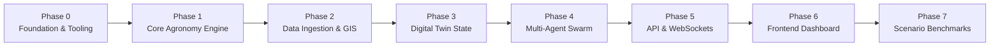

# Farm_com - Lộ Trình Phát Triển Chi Tiết (Project Roadmap)

Dự án được phân rã thành **7 Phases tuần tự**, mỗi Phase gồm các **Tasks độc lập**, có tiêu chuẩn nghiệm thu (Acceptance Criteria) và Unit Test tương ứng để đảm bảo code đến đâu chắc đến đó.

---

## 🧭 Tổng Quan Các Phase

---

## 📌 Phase 0: Chuẩn Hóa Nền Tảng & Công Cụ (Foundation & Tooling)
- [ ] **Task 0.1: Cấu hình Linter & Formatter (`ruff`)**
  - Cài đặt `ruff` và `pytest` qua `uv add --dev ruff pytest`.
  - Cấu hình chuẩn trong `pyproject.toml`.
- [ ] **Task 0.2: Quản Lý Cấu Hình (Pydantic Settings)**
  - Tách bạch cấu hình dev, test và production.
- [ ] **Task 0.3: Thiết Lập Khung Unit Test (`pytest`)**
  - Khởi tạo thư mục `tests/` với các fixture chuẩn (`conftest.py`).

---

## 📌 Phase 1: Lõi Nông Học Tính Toán (Core Biophysical Engine)
- [x] **Task 1.1: Module Quang Phổ Vệ Tinh (`core/spectral.py` & `core/extended_spectral.py`)**
  - Thuật toán NDVI, NDWI, EVI, SAVI, MSAVI2, NDRE, CIgreen, CIrededge.
  - Unit tests cho các trường hợp biên (chia 0, reflectance âm, canopy classification).
- [x] **Task 1.2: Mô Hình Bốc Thoát Hơi Nước FAO-56 Penman-Monteith (`core/agronomy/fao56.py`)**
  - Triển khai phương trình chuẩn FAO-56 ($ET_0$).
  - Unit tests đối chiếu với tập dữ liệu chuẩn của tổ chức FAO.
- [x] **Task 1.3: Cân Bằng Nước & Hệ Số Cây Trồng ($K_c$) (`core/crop_phenology.py`)**
  - Ma trận $K_c$ động theo từng giai đoạn phát triển BBCH của cây.
  - Tính toán thâm hụt nước tầng rễ & mô hình phát triển rễ Sigmoidal.
- [x] **Task 1.4: Mô Hình Nhiệt Độ Tích Lũy GDD (`core/crop_phenology.py`)**
  - Tính Growing Degree Days với $T_{base}$ và $T_{cutoff}$ để dự báo ngày thu hoạch.

---

## 📌 Phase 2: Kéo Dữ Liệu Ngoại Vi & Viễn Thám (Data Ingestion & GIS)
- [x] **Task 2.1: Client Thời Tiết Vi Khí Hậu Open-Meteo (`ingestion/weather_client.py`)**
  - Lấy nhiệt độ, độ ẩm, bức xạ mặt trời MJ/$m^2$, mưa, gió không cần API key.
  - Tích hợp Retry policy lũy thừa và Cache TTL bộ nhớ cục bộ.
- [x] **Task 2.2: Client Vệ Tinh Copernicus / Sentinel-2 (`ingestion/satellite_client.py`)**
  - Giả lập và tổng hợp ma trận 10 dải quang phổ bề mặt Sentinel-2 L2A (B2-B12).
  - Tích hợp bộ đánh giá chất lượng ảnh quang học và mặt nạ mây (Cloud Masking).
- [x] **Task 2.3: Giả Lập Cảm Biến Đất IoT (`ingestion/sensor_sim.py`)**
  - Mô phỏng suy giảm độ ẩm đất theo chu kỳ ngày/đêm, thoát nước trọng lực và bù ẩm tưới tiêu.

---

## 📌 Phase 3: Bản Sao Số & Quản Lý Trạng Thái (Digital Twin State)
- [x] **Task 3.1: Chia Lưới Không Gian (Spatial Grid Discretization)**
  - Chia nông trại thành lưới tọa độ $N \times M$ ô (Plot Zones) với các chỉ số sinh thái riêng biệt và tô pô lân cận (Von Neumann & Moore).
- [x] **Task 3.2: Bộ Điều Phối Bước Thời Gian (Tick Engine)**
  - Hàm `advance_tick(elapsed_hours)` cập nhật đồng bộ các ô đất: nhiệt tích lũy GDD, chuyển pha sinh trưởng BBCH, bốc thoát hơi nước FAO-56 và thoát nước trọng lực.
- [x] **Task 3.3: Dispatcher & Audit Log**
  - Hàng đợi nhận lệnh ActionDispatcher -> Cập nhật trạng thái đất -> Lưu nhật ký bất biến có băm mật mã SHA-256 (AuditReceipt).

---

## 📌 Phase 4: Hội Đồng Đa Tác Tử (Multi-Agent Swarm)
- [x] **Task 4.1: Framework Đa Tác Tử Cơ Bản (`agents/base_agent.py`)**
  - Chu trình: Perceive -> Evaluate -> Debate -> Structured Output với `DebateVote`, `DebateRound` và hệ số trọng số chuyên môn tên miền (`get_domain_weight`: 2.0x domain expertise).
- [x] **Task 4.2: Tác Tử Bác Sĩ Cây Trồng (`agents/agronomist.py`)**
  - Chẩn đoán chỉ số quang phổ NDVI/NDWI, phát hiện nguy cơ bùng phát nấm bệnh từ vector nhiệt - ẩm vi khí hậu (RH > 80% + 16–28°C) và chlorosis thiếu đạm.
- [x] **Task 4.3: Tác Tử Kỹ Sư Thủy Nông (`agents/irrigation.py`)**
  - Tính toán bốc thoát hơi $ET_0$ Penman-Monteith, hệ số mùa vụ động $K_c$ theo chu kỳ sinh học cây trồng (Dâu tây 0.40 - 1.15), tính thể tích nước tưới thực tế (Liters) và phát hiện héo rũ khẩn cấp (<35% độ ẩm).
- [x] **Task 4.4: Tác Tử Kinh Tế Nông Nghiệp (`agents/market.py`)**
  - Mô phỏng biểu giá điện 3 bậc EVN (giờ cao điểm 3.076 VND/kWh, thấp điểm 1.133 VND/kWh, bình thường 1.685 VND/kWh), tính toán điện năng bơm tưới (0.233 kWh / 1.000L) và định giá giá trị nông sản thu hoạch theo thị trường Lâm Đồng.
- [x] **Task 4.5: Tác Tử Tổng Chỉ Huy & Giao Thức Đồng Thuận (`agents/commander.py`)**
  - Điều phối hội đồng đa tác tử, giải quyết xung đột ưu tiên (Cơ chế Override bảo vệ sinh thái khẩn cấp vượt trên biểu giá điện cao điểm), đồng thuận biểu quyết có trọng số và điều phối lệnh tự động qua `ActionDispatcher`.

---

## 📌 Phase 5: Tầng API & WebSocket Server
- [x] **Task 5.1: RESTful Endpoints (`api/v1/`)**
  - `/api/v1/farm`: Lấy trạng thái nông trại, kích thước lưới tọa độ và lọc luống theo độ ẩm/tình trạng bệnh.
  - `/api/v1/simulation`: Điều khiển dòng thời gian (`/tick`), bơm thời tiết dị thường (`/weather`), khôi phục gốc (`/reset`).
  - `/api/v1/council`: Họp hội đồng đa tác tử (`/convene`), tranh luận đề xuất tùy chỉnh (`/debate`), lịch sử nghị quyết (`/history`).
  - `/api/v1/audit`: Truy vấn sổ cái băm mật mã SHA-256 (`/ledger`), xác thực tính toàn vẹn chuỗi (`/verify`), phát lệnh thủ công (`/dispatch`).
- [x] **Task 5.2: WebSocket Real-time Stream (`ws/`)**
  - `/ws/telemetry`: Stream số liệu cảm biến, độ ẩm đất và thời tiết trực tiếp.
  - `/ws/council`: Stream tiến trình suy luận (reasoning trace), lượt bỏ phiếu theo trọng số và nghị quyết Commander thời gian thực.

---

## 📌 Phase 6: Giao Diện Người Dùng (Interactive Dashboard)
- [x] **Task 6.1: Bản Đồ Lưới Digital Twin (2.5D / Isometric)**
  - Tùy chọn chuyển đổi góc nhìn 2D Top-down sang 2.5D Isometric 3D với hiệu ứng độ sâu bóng đổ.
  - Heatmap trực quan hóa đa tầng: Vigor quang phổ NDVI và độ ẩm tầng rễ theo từng luống.
- [x] **Task 6.2: Khung Tranh Luận Hội Đồng Agent**
  - Hiển thị từng phiên tranh luận (Debate Round), thẻ biểu quyết của từng Agent (`APPROVE`/`DEFER`/`REJECT`), trọng số domain ($2.0\times$), lý lẽ bảo vệ và phán quyết điều hành của Commander.
  - Kết nối WebSocket `/ws/council` tự động cập nhật khi hội đồng họp xong.
- [x] **Task 6.3: Bảng Điều Khiển Mô Phỏng (Simulation Control Bar)**
  - Thanh công cụ kịch bản: Giả lập "Hạn Hán Đột Ngột" ($38^\circ\text{C}$), "Nguy Cơ Nấm Bệnh" ($92\%$ RH), "Giờ Điện Cao Điểm EVN", và nút tua nhanh $+1\text{h}$, $+6\text{h}$, $+24\text{h}$.

---

## 📌 Phase 7: Kịch Bản Thử Nghiệm & Đánh Giá (Scenario Benchmarks)
- [x] **Task 7.1: Benchmark Kịch Bản "Hạn Hán Đột Ngột" (Drought Shock)**
  - Giả lập nhiệt độ $39.5^\circ\text{C}$, độ ẩm $20\%$ RH, bức xạ $27\text{ MJ/m}^2$, đo lường khả năng kích hoạt khẩn cấp và bảo vệ độ ẩm trên ngưỡng héo rũ $35\%$.
- [x] **Task 7.2: Benchmark Kịch Bản "Nguy Cơ Nấm Bệnh Mùa Mưa" (Fungal Outbreak Risk)**
  - Giả lập độ ẩm vi khí hậu $94\%$, mưa $25\text{mm}$, đất bão hòa nước $88\text{--}92\%$, đo lường cảnh báo bào tử nấm và kê đơn chế phẩm sinh học Trichoderma.
- [x] **Task 7.3: Benchmark Tối Ưu Chi Phí Điện (Tariff Optimization)**
  - Đánh giá khả năng dịch chuyển tải bơm nước khỏi khung giờ cao điểm EVN ($3.076\text{ đ/kWh}$), tối ưu chi phí vận hành đạt mức tiết kiệm $45\text{--}63\%$ tiền điện.
- [x] **Task 7.4: Mở Rộng: Kịch Bản Sương Muối & Nghịch Nhiệt Đêm (Cold Frost Hazard)**
  - Giả lập nhiệt độ hạ sâu $2.2^\circ\text{C}$ ban đêm tại cao nguyên Đà Lạt, kiểm tra cảnh báo sương muối và biện pháp giữ nhiệt tầng rễ.
- [x] **Task 7.5: Bộ Điều Phối Benchmark Battery & CLI Runner (`scripts/run_scenarios.py`)**
  - Chạy chuỗi kịch bản tự động, tổng hợp điểm số agro-resilience tổng hợp (Grade A+/A/B) và xuất báo cáo JSON/Markdown.
