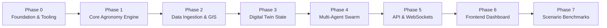

# Farm_com - Lộ Trình Phát Triển Chi Tiết (Project Roadmap)

Dự án được phân rã thành **7 Phases tuần tự**, mỗi Phase gồm các **Tasks độc lập**, có tiêu chuẩn nghiệm thu (Acceptance Criteria) và Unit Test tương ứng để đảm bảo code đến đâu chắc đến đó.

---

## 🧭 Tổng Quan Các Phase

---

## 📌 Phase 0: Chuẩn Hóa Nền Tảng & Công Cụ (Foundation & Tooling)
- [ ] **Task 0.1: Cấu hình Linter & Formatter (`ruff`)**
  - Cài đặt `ruff` và `pytest` qua `uv add --dev ruff pytest`.
  - Cấu hình chuẩn trong `pyproject.toml`.
- [ ] **Task 0.2: Quản Lý Cấu Hình (Pydantic Settings)**
  - Tách bạch cấu hình dev, test và production.
- [ ] **Task 0.3: Thiết Lập Khung Unit Test (`pytest`)**
  - Khởi tạo thư mục `tests/` với các fixture chuẩn (`conftest.py`).

---

## 📌 Phase 1: Lõi Nông Học Tính Toán (Core Biophysical Engine)
- [x] **Task 1.1: Module Quang Phổ Vệ Tinh (`core/spectral.py` & `core/extended_spectral.py`)**
  - Thuật toán NDVI, NDWI, EVI, SAVI, MSAVI2, NDRE, CIgreen, CIrededge.
  - Unit tests cho các trường hợp biên (chia 0, reflectance âm, canopy classification).
- [x] **Task 1.2: Mô Hình Bốc Thoát Hơi Nước FAO-56 Penman-Monteith (`core/agronomy/fao56.py`)**
  - Triển khai phương trình chuẩn FAO-56 ($ET_0$).
  - Unit tests đối chiếu với tập dữ liệu chuẩn của tổ chức FAO.
- [x] **Task 1.3: Cân Bằng Nước & Hệ Số Cây Trồng ($K_c$) (`core/crop_phenology.py`)**
  - Ma trận $K_c$ động theo từng giai đoạn phát triển BBCH của cây.
  - Tính toán thâm hụt nước tầng rễ & mô hình phát triển rễ Sigmoidal.
- [x] **Task 1.4: Mô Hình Nhiệt Độ Tích Lũy GDD (`core/crop_phenology.py`)**
  - Tính Growing Degree Days với $T_{base}$ và $T_{cutoff}$ để dự báo ngày thu hoạch.

---

## 📌 Phase 2: Kéo Dữ Liệu Ngoại Vi & Viễn Thám (Data Ingestion & GIS)
- [x] **Task 2.1: Client Thời Tiết Vi Khí Hậu Open-Meteo (`ingestion/weather_client.py`)**
  - Lấy nhiệt độ, độ ẩm, bức xạ mặt trời MJ/$m^2$, mưa, gió không cần API key.
  - Tích hợp Retry policy lũy thừa và Cache TTL bộ nhớ cục bộ.
- [x] **Task 2.2: Client Vệ Tinh Copernicus / Sentinel-2 (`ingestion/satellite_client.py`)**
  - Giả lập và tổng hợp ma trận 10 dải quang phổ bề mặt Sentinel-2 L2A (B2-B12).
  - Tích hợp bộ đánh giá chất lượng ảnh quang học và mặt nạ mây (Cloud Masking).
- [x] **Task 2.3: Giả Lập Cảm Biến Đất IoT (`ingestion/sensor_sim.py`)**
  - Mô phỏng suy giảm độ ẩm đất theo chu kỳ ngày/đêm, thoát nước trọng lực và bù ẩm tưới tiêu.

---

## 📌 Phase 3: Bản Sao Số & Quản Lý Trạng Thái (Digital Twin State)
- [x] **Task 3.1: Chia Lưới Không Gian (Spatial Grid Discretization)**
  - Chia nông trại thành lưới tọa độ $N \times M$ ô (Plot Zones) với các chỉ số sinh thái riêng biệt và tô pô lân cận (Von Neumann & Moore).
- [x] **Task 3.2: Bộ Điều Phối Bước Thời Gian (Tick Engine)**
  - Hàm `advance_tick(elapsed_hours)` cập nhật đồng bộ các ô đất: nhiệt tích lũy GDD, chuyển pha sinh trưởng BBCH, bốc thoát hơi nước FAO-56 và thoát nước trọng lực.
- [x] **Task 3.3: Dispatcher & Audit Log**
  - Hàng đợi nhận lệnh ActionDispatcher -> Cập nhật trạng thái đất -> Lưu nhật ký bất biến có băm mật mã SHA-256 (AuditReceipt).

---

## 📌 Phase 4: Hội Đồng Đa Tác Tử (Multi-Agent Swarm)
- [x] **Task 4.1: Framework Đa Tác Tử Cơ Bản (`agents/base_agent.py`)**
  - Chu trình: Perceive -> Evaluate -> Debate -> Structured Output với `DebateVote`, `DebateRound` và hệ số trọng số chuyên môn tên miền (`get_domain_weight`: 2.0x domain expertise).
- [x] **Task 4.2: Tác Tử Bác Sĩ Cây Trồng (`agents/agronomist.py`)**
  - Chẩn đoán chỉ số quang phổ NDVI/NDWI, phát hiện nguy cơ bùng phát nấm bệnh từ vector nhiệt - ẩm vi khí hậu (RH > 80% + 16–28°C) và chlorosis thiếu đạm.
- [x] **Task 4.3: Tác Tử Kỹ Sư Thủy Nông (`agents/irrigation.py`)**
  - Tính toán bốc thoát hơi $ET_0$ Penman-Monteith, hệ số mùa vụ động $K_c$ theo chu kỳ sinh học cây trồng (Dâu tây 0.40 - 1.15), tính thể tích nước tưới thực tế (Liters) và phát hiện héo rũ khẩn cấp (<35% độ ẩm).
- [x] **Task 4.4: Tác Tử Kinh Tế Nông Nghiệp (`agents/market.py`)**
  - Mô phỏng biểu giá điện 3 bậc EVN (giờ cao điểm 3.076 VND/kWh, thấp điểm 1.133 VND/kWh, bình thường 1.685 VND/kWh), tính toán điện năng bơm tưới (0.233 kWh / 1.000L) và định giá giá trị nông sản thu hoạch theo thị trường Lâm Đồng.
- [x] **Task 4.5: Tác Tử Tổng Chỉ Huy & Giao Thức Đồng Thuận (`agents/commander.py`)**
  - Điều phối hội đồng đa tác tử, giải quyết xung đột ưu tiên (Cơ chế Override bảo vệ sinh thái khẩn cấp vượt trên biểu giá điện cao điểm), đồng thuận biểu quyết có trọng số và điều phối lệnh tự động qua `ActionDispatcher`.

---

## 📌 Phase 5: Tầng API & WebSocket Server
- [x] **Task 5.1: RESTful Endpoints (`api/v1/`)**
  - `/api/v1/farm`: Lấy trạng thái nông trại, kích thước lưới tọa độ và lọc luống theo độ ẩm/tình trạng bệnh.
  - `/api/v1/simulation`: Điều khiển dòng thời gian (`/tick`), bơm thời tiết dị thường (`/weather`), khôi phục gốc (`/reset`).
  - `/api/v1/council`: Họp hội đồng đa tác tử (`/convene`), tranh luận đề xuất tùy chỉnh (`/debate`), lịch sử nghị quyết (`/history`).
  - `/api/v1/audit`: Truy vấn sổ cái băm mật mã SHA-256 (`/ledger`), xác thực tính toàn vẹn chuỗi (`/verify`), phát lệnh thủ công (`/dispatch`).
- [x] **Task 5.2: WebSocket Real-time Stream (`ws/`)**
  - `/ws/telemetry`: Stream số liệu cảm biến, độ ẩm đất và thời tiết trực tiếp.
  - `/ws/council`: Stream tiến trình suy luận (reasoning trace), lượt bỏ phiếu theo trọng số và nghị quyết Commander thời gian thực.

---

## 📌 Phase 6: Giao Diện Người Dùng (Interactive Dashboard)
- [x] **Task 6.1: Bản Đồ Lưới Digital Twin (2.5D / Isometric)**
  - Tùy chọn chuyển đổi góc nhìn 2D Top-down sang 2.5D Isometric 3D với hiệu ứng độ sâu bóng đổ.
  - Heatmap trực quan hóa đa tầng: Vigor quang phổ NDVI và độ ẩm tầng rễ theo từng luống.
- [x] **Task 6.2: Khung Tranh Luận Hội Đồng Agent**
  - Hiển thị từng phiên tranh luận (Debate Round), thẻ biểu quyết của từng Agent (`APPROVE`/`DEFER`/`REJECT`), trọng số domain ($2.0\times$), lý lẽ bảo vệ và phán quyết điều hành của Commander.
  - Kết nối WebSocket `/ws/council` tự động cập nhật khi hội đồng họp xong.
- [x] **Task 6.3: Bảng Điều Khiển Mô Phỏng (Simulation Control Bar)**
  - Thanh công cụ kịch bản: Giả lập "Hạn Hán Đột Ngột" ($38^\circ\text{C}$), "Nguy Cơ Nấm Bệnh" ($92\%$ RH), "Giờ Điện Cao Điểm EVN", và nút tua nhanh $+1\text{h}$, $+6\text{h}$, $+24\text{h}$.

---

## 📌 Phase 7: Kịch Bản Thử Nghiệm & Đánh Giá (Scenario Benchmarks)
- [x] **Task 7.1: Benchmark Kịch Bản "Hạn Hán Đột Ngột" (Drought Shock)**
  - Giả lập nhiệt độ $39.5^\circ\text{C}$, độ ẩm $20\%$ RH, bức xạ $27\text{ MJ/m}^2$, đo lường khả năng kích hoạt khẩn cấp và bảo vệ độ ẩm trên ngưỡng héo rũ $35\%$.
- [x] **Task 7.2: Benchmark Kịch Bản "Nguy Cơ Nấm Bệnh Mùa Mưa" (Fungal Outbreak Risk)**
  - Giả lập độ ẩm vi khí hậu $94\%$, mưa $25\text{mm}$, đất bão hòa nước $88\text{--}92\%$, đo lường cảnh báo bào tử nấm và kê đơn chế phẩm sinh học Trichoderma.
- [x] **Task 7.3: Benchmark Tối Ưu Chi Phí Điện (Tariff Optimization)**
  - Đánh giá khả năng dịch chuyển tải bơm nước khỏi khung giờ cao điểm EVN ($3.076\text{ đ/kWh}$), tối ưu chi phí vận hành đạt mức tiết kiệm $45\text{--}63\%$ tiền điện.
- [x] **Task 7.4: Mở Rộng: Kịch Bản Sương Muối & Nghịch Nhiệt Đêm (Cold Frost Hazard)**
  - Giả lập nhiệt độ hạ sâu $2.2^\circ\text{C}$ ban đêm tại cao nguyên Đà Lạt, kiểm tra cảnh báo sương muối và biện pháp giữ nhiệt tầng rễ.
- [x] **Task 7.5: Bộ Điều Phối Benchmark Battery & CLI Runner (`scripts/run_scenarios.py`)**
  - Chạy chuỗi kịch bản tự động, tổng hợp điểm số agro-resilience tổng hợp (Grade A+/A/B) và xuất báo cáo JSON/Markdown.

---

## 📌 Phase 8: Đồng Bộ Hóa Viễn Thám & Xuất Dữ Liệu Đo Đạc (Data Assimilation & Telemetry Export)
- [x] **Task 8.1: Động Cơ Đồng Bộ Dữ Liệu Kalman Filter (`backend/core/assimilation.py`)**
  - Hiện thực hóa 1D Kalman Filter nội suy liên tục trạng thái thực vật (NDVI/NDWI) giữa các chu kỳ vệ tinh Sentinel-2 (5 ngày/lần).
  - Tích hợp mô hình vật lý suy biến tán lá theo vi khí hậu (VPD, độ ẩm đất) và phạt bất định khi mây mù che phủ bề mặt.
- [x] **Task 8.2: Công Cụ Xuất Dữ Liệu Thời Gian Thực (`backend/core/telemetry_export.py`)**
  - Xuất dữ liệu chuỗi thời gian các PlotZone, vi khí hậu thời tiết và nhật ký hành động hội đồng ra định dạng chuẩn CSV (RFC 4180) và JSON.
  - Tổng hợp thống kê nông trại (phân bố cây trồng, độ ẩm bình quân, NDVI bình quân).
- [x] **Task 8.3: Điểm Cuối RESTful Telemetry Export (`backend/api/v1/endpoints/farm.py`)**
  - `/api/v1/farm/export/summary`: Thống kê tổng hợp số liệu sinh trắc học và hiện trạng nông trại.
  - `/api/v1/farm/export/zones`: Tải về dữ liệu trắc quang các vùng canh tác (`format=csv` hoặc `json`).
  - `/api/v1/farm/export/actions`: Tải về lịch sử điều hành và phán quyết hội đồng Agent.
  - `/api/v1/farm/export/full`: Sao lưu toàn diện Digital Twin dạng tệp tin snapshot JSON.
- [x] **Task 8.4: Kiểm Thử Tự Động Toàn Diện**
  - 135/135 Unit & Integration tests vượt qua thành công 100% (`tests/test_assimilation.py`, `tests/test_export.py`).

---

## 📌 Phase 9: Hạ Tầng IoT Biên, Thủy Nông Hồ Chứa & Châm Phân Bón (IoT Edge & Precision Fertigation)
- [x] **Task 9.1: Bộ Giải Mã & Đóng Gói Nhị Phân LoRaWAN (`backend/ingestion/lorawan_codec.py`)**
  - Hiện thực hóa cấu trúc gói tin nén 12 bytes chuẩn hóa (AS923/EU868) cho vi điều khiển ESP32-S3/SX1262.
  - Tích hợp kiểm tra toàn vẹn mã CRC-8 Dallas/Maxim, tọa độ không gian 4-bit và cờ cảnh báo điện áp/độ mặn.
- [x] **Task 9.2: Động Cơ Quản Lý Hồ Chứa Thủy Nông & Hạn Hán (`backend/core/water_budget.py`)**
  - Mô phỏng dung tích hồ chứa ($50.000\text{ L}$), bổ cập nước ngầm tự nhiên và thu hoạch nước mưa.
  - Phân tầng hạn ngạch cấp nước 5 cấp độ (`abundant`, `normal`, `moderate_deficit`, `severe_drought`, `critical_empty`).
- [x] **Task 9.3: Tối Ưu Hóa Dinh Dưỡng N-P-K & EC/pH Châm Phân (`backend/core/fertigation.py`)**
  - Ma trận dinh dưỡng chuyên sâu theo loại cây (Dâu tây, Ớt chuông, Cà phê Arabica) và từng thời kỳ phát triển (ra hoa, nuôi quả).
  - Tự động tính toán tỷ lệ châm Bể A (Canxi nitrat), Bể B (Photphat, Kali) và đệm axit trung hòa nước kiềm.
- [x] **Task 9.4: Kiểm Soát Sốc Nhiệt Tán Lá & Phun Sương Hạ Nhiệt (`backend/core/heat_stress.py`)**
  - Động lực học thâm hụt áp suất hơi nước ($VPD$) và chỉ số sốc nhiệt Steadman.
  - Điều phối các xung phun sương vi hạt ($< 20\mu\text{m}$) hạ nhiệt độ tán $3.5\text{--}5^\circ\text{C}$ mà không làm úng gốc rễ.
- [x] **Task 9.5: Mở Rộng Hội Đồng Đa Tác Tử (Agent Council Integration)**
  - `IrrigationAgent`: Tự động siết hạn ngạch theo trữ lượng hồ chứa, phủ quyết tưới định kỳ khi hồ cạn kiệt.
  - `AgronomistAgent`: Phát hiện sốc nhiệt cực đoan và kích hoạt phủ quyết bệnh lý khi độ ẩm không khí vượt $85\%$.
- [x] **Task 9.6: Điểm Cuối RESTful IoT & Fertigation API (`endpoints/iot.py`, `endpoints/fertigation.py`)**
  - `/api/v1/iot/lorawan/uplink` & `/lorawan/simulate`: Tiếp nhận dữ liệu trắc quan không dây từ Gateway ngoài trời.
  - `/api/v1/fertigation/recipes` & `/water-budget`: Cung cấp công thức châm phân và báo cáo tự chủ nguồn nước.
- [x] **Task 9.7: Nâng Cấp Giao Diện Bảng Điều Khiển (`backend/static/index.html`)**
  - Thẻ trực quan hóa trạng thái mạng LoRaWAN, thanh đo trữ lượng hồ nước và trạng thái phun sương thời gian thực.
- [x] **Task 9.8: Bộ Kiểm Thử Tự Động Toàn Diện**
  - 167/167 Unit & Integration tests vượt qua thành công 100% (`tests/test_lorawan_codec.py`, `tests/test_water_budget.py`, `tests/test_fertigation.py`, `tests/test_heat_stress.py`, `tests/test_agent_extensions.py`, `tests/test_iot_fertigation_api.py`).

---

## 📌 Phase 10: Kế Toán Carbon GHG, Dịch Tễ Bệnh Học & An Ninh Sinh Học (Carbon Accounting & Biosecurity)
- [x] **Task 10.1: Động Cơ Kế Toán Khí Nhà Kính & Dấu Chân Carbon (`backend/core/carbon_accounting.py`)**
  - Hiện thực hóa hướng dẫn IPCC Tier 1 & GHG Protocol cho nông nghiệp thông minh.
  - Phân tách Scope 1 (phát thải trực tiếp $N_2O$ từ phân đạm), Scope 2 (điện năng bơm tưới lưới EVN $0.7221\text{ kg CO}_2\text{e/kWh}$) và tín chỉ hấp thụ carbon hữu cơ của đất (SOC Sink).
- [x] **Task 10.2: Mô Hình Dịch Tễ Học Nấm Bệnh Vi Khí Hậu (`backend/core/epidemiology.py`)**
  - Mô phỏng động học nấm mốc xám *Botrytis cinerea* (hàm Broome nhiệt ẩm), nấm thối gốc rễ *Phytophthora cactorum* (ngập úng tầng rễ) và bệnh phấn trắng *Podosphaera aphanis*.
  - Tự động kê đơn giải pháp sinh học IPM (*Bacillus subtilis*, *Trichoderma asperellum*).
- [x] **Task 10.3: Mở Rộng Cơ Chế Trọng Tài An Ninh Sinh Học & Chi Phí Carbon**
  - `MarketAgent`: Tích hợp chi phí phát thải Scope 2 và thuế carbon vào tối ưu hóa vận hành bơm.
  - `CommanderAgent`: Bổ sung luật trọng tài Biosecurity Veto, ngăn ngừa tưới vào đất bão hòa nấm bệnh.
- [x] **Task 10.4: Điểm Cuối RESTful Carbon & Dịch Tễ Học (`endpoints/carbon.py`, `endpoints/epidemiology.py`)**
  - `/api/v1/carbon/footprint` & `/carbon/zones/{id}`: Truy vấn báo cáo kiểm toán GHG và xếp hạng khí hậu.
  - `/api/v1/epidemiology/biosecurity` & `/ipm-advisories`: Trích xuất radar rủi ro mầm bệnh và khuyến nghị sinh học.
- [x] **Task 10.5: Kịch Bản Benchmark An Ninh Sinh Học (`backend/benchmarks/biosecurity_hazard.py`)**
  - Giả lập đợt bùng phát đa mầm bệnh (mưa $28\text{mm}$, độ ẩm $93.5\%$), đánh giá phản xạ phủ quyết và triển khai chế phẩm sinh học.
- [x] **Task 10.6: Nâng Cấp Giao Diện Bảng Điều Khiển (`backend/static/index.html`)**
  - Tích hợp 2 thẻ HUD: Dấu Chân Carbon GHG Protocol (xếp hạng khí hậu) và Radar Dịch Bệnh An Ninh Sinh Học.
- [x] **Task 10.7: Bộ Kiểm Thử Tự Động Toàn Diện**
  - 191/191 Unit & Integration tests vượt qua thành công 100% (`tests/test_carbon_accounting.py`, `tests/test_epidemiology.py`, `tests/test_carbon_council.py`, `tests/test_carbon_epidemiology_api.py`, `tests/test_scenario_biosecurity.py`).

---

## 📌 Phase 11: Lưới Điện Nông Nghiệp Tự Chủ & Năng Lượng Tái Tạo (Agrivoltaics & Micro-Grid Energy)
- [x] **Task 11.1: Động Cơ Lưới Điện Quang Năng & Pin Lưu Trữ BESS (`backend/core/microgrid.py`)**
  - Mô phỏng giàn quang điện nông nghiệp (Agrivoltaics Solar PV, công suất 25 kWp, suy giảm nhiệt độ pin).
  - Hệ thống lưu trữ năng lượng pin Lithium LFP (BESS 40 kWh, hiệu suất khứ hồi 92%, giới hạn C-rate và ngưỡng SoC an toàn).
  - Chiến lược điều phối thông minh: Tự dùng năng lượng mặt trời (Self-consumption), Cắt giảm đỉnh phụ tải giá cao (Peak-shaving) và Cô lập khẩn cấp khi mất điện lưới EVN (Emergency islanding).
- [x] **Task 11.2: Mở Rộng Tác Tử Kinh Tế Với Cơ Chế Kinh Doanh Năng Lượng**
  - `MarketAgent`: Tích hợp phân tích kinh tế pin BESS, đề xuất nạp điện giờ thấp điểm EVN (1,400 đ/kWh) và xả điện trong khung giờ cao điểm (3,076 đ/kWh) để cấp điện cho hệ thống bơm tưới với chi phí tối thiểu.
- [x] **Task 11.3: Điểm Cuối RESTful Quản Lý Năng Lượng (`endpoints/microgrid.py`)**
  - `/api/v1/microgrid/status`: Truy vấn công suất phát quang điện, tỷ lệ SoC pin và năng lượng lưu trữ khả dụng.
  - `/api/v1/microgrid/dispatch`: Tính toán phân bổ luồng công suất tối ưu giữa Điện mặt trời, Pin BESS và Lưới EVN.
  - `/api/v1/microgrid/tariffs`: Bảng tra cứu khung giờ và đơn giá biểu giá điện 3 giá của EVN.
- [x] **Task 11.4: Kịch Bản Benchmark Mất Điện Lưới & Đảo Lưới Quang Năng (`backend/benchmarks/grid_blackout.py`)**
  - Giả lập sự cố mất điện lưới EVN giữa trưa nắng gắt (32.5°C, bức xạ 850 W/m²), kiểm chứng khả năng chuyển đổi tức thì sang chế độ đảo lưới độc lập, duy trì phun sương làm mát và bảo vệ ngưỡng pin.

---

## 📌 Phase 12: Khảo Sát Drone Đa Phổ UAV & Dự Báo Sản Lượng Thu Hoạch (Drone Scouting & Crop Yield Logistics)
- [x] **Task 12.1: Động Cơ Khảo Sát Drone Đa Phổ & Thị Giác Máy Tính Tán Lá (`backend/core/drone_scouting.py`)**
  - Mô phỏng chuyến bay khảo sát tự động của thiết bị bay không người lái (UAV) độ phân giải dưới centimet.
  - Xử lý 5 kênh phản xạ bề mặt (Red, Green, Blue, RedEdge, NIR), tính toán chỉ số VARI, NDRE, tỷ lệ che phủ tán ($f_{cover}$), phát hiện lỗ khuyết nảy mầm và cụm cỏ dại xen hàng.
- [x] **Task 12.2: Mô Hình Dự Báo Sản Lượng Sinh Học & Hậu Cần Thu Hoạch (`backend/core/yield_prediction.py`)**
  - Tích hợp hàm sản xuất nước FAO 33/66 ($1 - Y_a/Y_m = K_y \cdot [1 - ET_a/ET_c]$) và nhiệt độ tích lũy GDD.
  - Mô phỏng ngẫu nhiên Monte Carlo xác định khoảng tin cậy sản lượng p10, p50, p90 (tấn/ha).
  - Lập kế hoạch hậu cần sau thu hoạch: ước tính số thùng chứa 15kg, ca công nhân thu hái và điện năng làm mát sơ bộ kho lạnh.
- [x] **Task 12.3: Tích Hợp Tác Tử Nông Học Phân Tích Ảnh Không Ảnh**
  - `AgronomistAgent`: Tiếp nhận báo cáo trinh sát đa phổ UAV, tự động lập đơn thuốc phun biến thiên (VRA) cho các điểm vàng lá và xử lý cỏ dại cục bộ.
- [x] **Task 12.4: Điểm Cuối RESTful Drone & Dự Báo Sản Lượng (`endpoints/drone.py`, `endpoints/yield_forecast.py`)**
  - `/api/v1/drone/simulate-flight` & `/drone/anomalies`: Mô phỏng chuyến bay trinh sát và trích xuất điểm nóng dị thường.
  - `/api/v1/yield/forecast` & `/yield/zone-simulation`: Báo cáo dự báo sản lượng trang trại và kế hoạch hậu cần thu hoạch.
- [x] **Task 12.5: Nâng Cấp Bảng Điều Khiển Trực Quan (`backend/static/index.html`)**
  - Bổ sung 3 thẻ HUD thời gian thực: Thẻ Quang Điện & Pin Lưu Trữ BESS, Radar Khảo Sát Drone UAV, và Thẻ Dự Báo Sản Lượng Hậu Cần.
- [x] **Task 12.6: Bộ Kiểm Thử Tự Động Toàn Diện**
  - 223/223 Unit & Integration tests vượt qua thành công 100% (`tests/test_microgrid.py`, `tests/test_drone_scouting.py`, `tests/test_yield_prediction.py`, `tests/test_drone_microgrid_agents.py`, `tests/test_microgrid_api.py`, `tests/test_drone_api.py`, `tests/test_yield_api.py`, `tests/test_scenario_grid_blackout.py`).

---

## 📌 Phase 13: Chứng Nhận VietGAP / GlobalG.A.P., An Toàn Thực Phẩm & Truy Xuất Nguồn Gốc (Traceability & Food Safety)
- [x] **Task 13.1: Động Cơ Truy Xuất Nguồn Gốc & Kiểm Toán VietGAP (`backend/core/traceability.py`)**
  - Tuân thủ tiêu chuẩn VietGAP Trồng trọt (TCVN 11892-1:2017) và GlobalG.A.P. IFA v6.
  - Quản lý nhật ký can thiệp hóa chất, tự động tính toán thời gian cách ly thu hoạch Pre-Harvest Interval (PHI) ngăn ngừa dư lượng thuốc BVTV vượt ngưỡng MRL.
  - Giám sát an toàn sinh học & kim loại nặng nguồn nước tưới theo TCVN 6774:2000 (E. coli, Coliform, Pb, Cd, As).
  - Khởi tạo Hộ chiếu lô hàng số (Harvest Batch Passport) với chữ ký số SHA-256 bất biến và mã QR truy xuất minh bạch.
- [x] **Task 13.2: Mở Rộng Trọng Tài Tác Tử Chỉ Huy Với Phủ Quyết An Toàn Thực Phẩm**
  - `CommanderAgent`: Tự động kích hoạt quy tắc trọng tài *VietGAP PHI Veto*, kiên quyết phủ quyết và đình chỉ thu hoạch đối với mọi lô đất đang trong thời gian cách ly hóa chất để bảo vệ sức khỏe người tiêu dùng và chứng chỉ xuất khẩu.
- [x] **Task 13.3: Điểm Cuối RESTful Truy Xuất & Chứng Nhận GAP (`endpoints/traceability.py`)**
  - `/api/v1/traceability/compliance-audit`: Báo cáo xếp hạng tuân thủ toàn diện (AAA Export Ready, AA Domestic Premium...).
  - `/api/v1/traceability/treatment/log`: Ghi nhật ký xử lý sinh học/hóa chất và kích hoạt bộ đếm thời gian cách ly.
  - `/api/v1/traceability/batch/passport`: Đúc hộ chiếu xuất khẩu điện tử có xác thực nguồn gốc mật mã học.
  - `/api/v1/traceability/water-quality`: Đánh giá mức độ an toàn của nguồn nước tưới.
- [x] **Task 13.4: Nâng Cấp Bảng Điều Khiển Trực Quan (`backend/static/index.html`)**
  - Tích hợp Thẻ Chứng Nhận VietGAP / GlobalG.A.P. & Truy Xuất Nguồn Gốc Lô Hàng vào bảng điều khiển trung tâm.
- [x] **Task 13.5: Bộ Kiểm Thử Tự Động Toàn Diện**
  - 234/234 Unit & Integration tests vượt qua thành công 100% (`tests/test_traceability.py`, `tests/test_traceability_api.py`).
