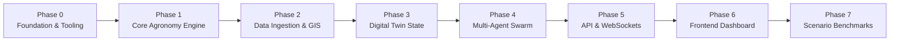

# Farm_com - Lộ Trình Phát Triển Chi Tiết (Project Roadmap)

Dự án được phân rã thành **7 Phases tuần tự**, mỗi Phase gồm các **Tasks độc lập**, có tiêu chuẩn nghiệm thu (Acceptance Criteria) và Unit Test tương ứng để đảm bảo code đến đâu chắc đến đó.

---

## 🧭 Tổng Quan Các Phase

---

## 📌 Phase 0: Chuẩn Hóa Nền Tảng & Công Cụ (Foundation & Tooling)
- [ ] **Task 0.1: Cấu hình Linter & Formatter (`ruff`)**
  - Cài đặt `ruff` và `pytest` qua `uv add --dev ruff pytest`.
  - Cấu hình chuẩn trong `pyproject.toml`.
- [ ] **Task 0.2: Quản Lý Cấu Hình (Pydantic Settings)**
  - Tách bạch cấu hình dev, test và production.
- [ ] **Task 0.3: Thiết Lập Khung Unit Test (`pytest`)**
  - Khởi tạo thư mục `tests/` với các fixture chuẩn (`conftest.py`).

---

## 📌 Phase 1: Lõi Nông Học Tính Toán (Core Biophysical Engine)
- [x] **Task 1.1: Module Quang Phổ Vệ Tinh (`core/spectral.py` & `core/extended_spectral.py`)**
  - Thuật toán NDVI, NDWI, EVI, SAVI, MSAVI2, NDRE, CIgreen, CIrededge.
  - Unit tests cho các trường hợp biên (chia 0, reflectance âm, canopy classification).
- [x] **Task 1.2: Mô Hình Bốc Thoát Hơi Nước FAO-56 Penman-Monteith (`core/agronomy/fao56.py`)**
  - Triển khai phương trình chuẩn FAO-56 ($ET_0$).
  - Unit tests đối chiếu với tập dữ liệu chuẩn của tổ chức FAO.
- [x] **Task 1.3: Cân Bằng Nước & Hệ Số Cây Trồng ($K_c$) (`core/crop_phenology.py`)**
  - Ma trận $K_c$ động theo từng giai đoạn phát triển BBCH của cây.
  - Tính toán thâm hụt nước tầng rễ & mô hình phát triển rễ Sigmoidal.
- [x] **Task 1.4: Mô Hình Nhiệt Độ Tích Lũy GDD (`core/crop_phenology.py`)**
  - Tính Growing Degree Days với $T_{base}$ và $T_{cutoff}$ để dự báo ngày thu hoạch.

---

## 📌 Phase 2: Kéo Dữ Liệu Ngoại Vi & Viễn Thám (Data Ingestion & GIS)
- [x] **Task 2.1: Client Thời Tiết Vi Khí Hậu Open-Meteo (`ingestion/weather_client.py`)**
  - Lấy nhiệt độ, độ ẩm, bức xạ mặt trời MJ/$m^2$, mưa, gió không cần API key.
  - Tích hợp Retry policy lũy thừa và Cache TTL bộ nhớ cục bộ.
- [x] **Task 2.2: Client Vệ Tinh Copernicus / Sentinel-2 (`ingestion/satellite_client.py`)**
  - Giả lập và tổng hợp ma trận 10 dải quang phổ bề mặt Sentinel-2 L2A (B2-B12).
  - Tích hợp bộ đánh giá chất lượng ảnh quang học và mặt nạ mây (Cloud Masking).
- [x] **Task 2.3: Giả Lập Cảm Biến Đất IoT (`ingestion/sensor_sim.py`)**
  - Mô phỏng suy giảm độ ẩm đất theo chu kỳ ngày/đêm, thoát nước trọng lực và bù ẩm tưới tiêu.

---

## 📌 Phase 3: Bản Sao Số & Quản Lý Trạng Thái (Digital Twin State)
- [ ] **Task 3.1: Chia Lưới Không Gian (Spatial Grid Discretization)**
  - Chia nông trại thành lưới tọa độ $N \times M$ ô (Plot Zones) với các chỉ số sinh thái riêng biệt.
- [ ] **Task 3.2: Bộ Điều Phối Bước Thời Gian (Tick Engine)**
  - Hàm `step_simulation(delta_hours)` cập nhật đồng bộ các ô đất.
- [ ] **Task 3.3: Dispatcher & Audit Log**
  - Hàng đợi nhận lệnh -> Cập nhật trạng thái đất -> Lưu nhật ký bất biến.

---

## 📌 Phase 4: Hội Đồng Đa Tác Tử (Multi-Agent Swarm)
- [ ] **Task 4.1: Framework Đa Tác Tử Cơ Bản (`agents/base.py`)**
  - Chu trình: Perceive -> Evaluate -> Debate -> Structured Output.
- [ ] **Task 4.2: Tác Tử Bác Sĩ Cây Trồng (`agents/agronomist.py`)**
  - Chẩn đoán diệp lục, phát hiện nguy cơ nấm bệnh từ tương quan nhiệt - ẩm.
- [ ] **Task 4.3: Tác Tử Kỹ Sư Thủy Nông (`agents/irrigation.py`)**
  - Quyết định lượng nước tưới dựa trên $ET_0$ và độ ẩm thực tế.
- [ ] **Task 4.4: Tác Tử Kinh Tế Nông Nghiệp (`agents/market.py`)**
  - Tối ưu tiền điện giờ cao điểm / thấp điểm và phân tích giá nông sản.
- [ ] **Task 4.5: Tác Tử Tổng Chỉ Huy & Giao Thức Đồng Thuận (`agents/commander.py`)**
  - Hòa giải các ý kiến mâu thuẫn giữa các Agent, chốt nghị quyết hành động.

---

## 📌 Phase 5: Tầng API & WebSocket Server
- [ ] **Task 5.1: RESTful Endpoints (`api/v1/`)**
  - `/api/v1/farm`: Lấy trạng thái nông trại và từng luống.
  - `/api/v1/simulation/tick`: Điều khiển dòng thời gian.
- [ ] **Task 5.2: WebSocket Real-time Stream (`ws/`)**
  - `/ws/telemetry`: Stream số liệu cảm biến trực tiếp.
  - `/ws/council`: Stream tiến trình suy luận (reasoning trace) khi các Agent họp.

---

## 📌 Phase 6: Giao Diện Người Dùng (Interactive Dashboard)
- [ ] **Task 6.1: Bản Đồ Lưới Digital Twin (2.5D / Isometric)**
  - Trực quan hóa màu sắc từng ô đất theo độ ẩm và sức khỏe diệp lục.
- [ ] **Task 6.2: Khung Tranh Luận Hội Đồng Agent**
  - Hiển thị từng lượt phát biểu và phán quyết của Commander.
- [ ] **Task 6.3: Bảng Điều Khiển Mô Phỏng (Simulation Control Bar)**
  - Nút bấm giả lập hạn hán, mưa rào, cúp điện để test phản ứng của đàn Agent.

---

## 📌 Phase 7: Kịch Bản Thử Nghiệm & Đánh Giá (Scenario Benchmarks)
- [ ] **Task 7.1: Benchmark Kịch Bản "Hạn Hán Đột Ngột" (Drought Shock)**
- [ ] **Task 7.2: Benchmark Kịch Bản "Nguy Cơ Nấm Bệnh Mùa Mưa" (Fungal Outbreak Risk)**
- [ ] **Task 7.3: Benchmark Tối Ưu Chi Phí Điện (Tariff Optimization)**
